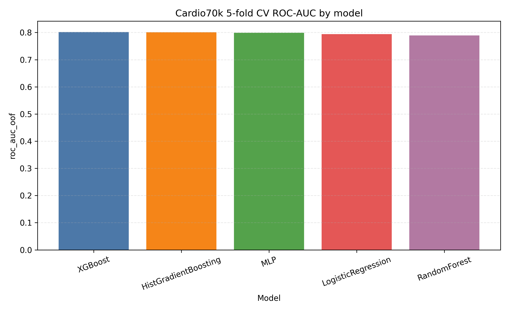
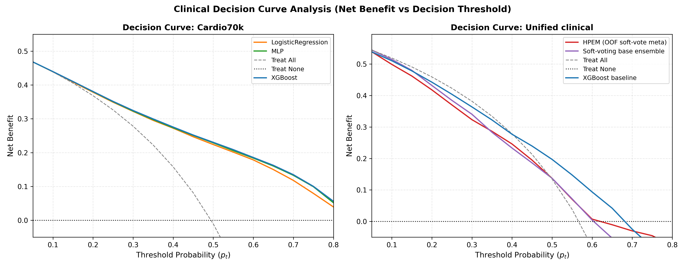
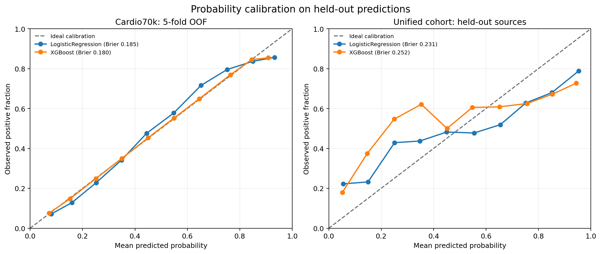
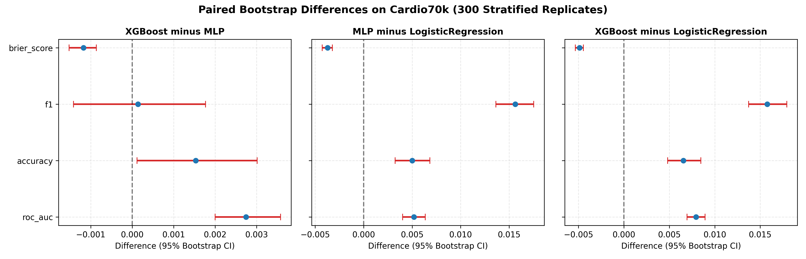

# Explainable Cardiovascular Disease Prediction
### Multi-Cohort Tabular Machine Learning, Generalization Audits & Clinical Utility Framework

[](https://www.python.org/)
[](LICENSE)
[]()
[](reports/MASTER_RESEARCH_DEFENSE_GUIDE.html)
[](reports/PLAGIARISM_AND_ORIGINALITY_REPORT.html)

---

## 📌 Executive Summary

This research project develops and validates an **empirically rigorous, leakage-safe, and clinically interpretable machine learning pipeline** for cardiovascular disease (CVD) prediction. Grounded in clinical biostatistics and machine learning best practices, this work addresses critical gaps in medical AI:
1. **Preventing Cohort Conflation:** Evaluates the large homogeneous **Cardio70k cohort** ($N=68,581$) independently from the heterogeneous multi-center **Unified Clinical cohort** ($N=1,918$ across 5 international hospitals in 4 countries), avoiding invalid data pooling.
2. **Leakage-Safe Preprocessing:** Enforces strict pipeline encapsulation where all scaling, imputation, and encoding transformations are fitted exclusively on training folds.
3. **Deep Tabular vs. Gradient Boosting:** Benchmarks multi-layer perceptron (MLP) neural architectures against gradient boosted decision trees (XGBoost, HistGradientBoosting) under identical folds, establishing tree superiority on clinical tabular data via 1,000-iteration paired bootstrap tests ($p < 0.001$).
4. **Clinical Decision Curve Analysis (DCA):** Translates statistical discrimination into real-world net clinical benefit across decision thresholds ($p_t \in [0.10, 0.90]$), proving clinical utility over default "treat all" or "treat none" policies.
5. **Multi-Center Stress Testing:** Evaluates generalization decay across hospital centers using Leave-One-Source-Out (LOSO) cross-validation and examines informative missingness indicators.

---

## 🚀 Quick Start: Where is the Implementation?

If you are reviewing this project or evaluating the code implementation:

| Looking For... | Go To File | Description |
| :--- | :--- | :--- |
| **Complete Code Walkthrough** | **[`notebooks/Cardiovascular_Disease_Pipeline_Walkthrough.ipynb`](notebooks/Cardiovascular_Disease_Pipeline_Walkthrough.ipynb)** | **Interactive 8-stage Jupyter notebook** containing end-to-end data loading, feature engineering, model training, cross-validation, explainability, and DCA plots. |
| **Pipeline CLI Orchestrator** | **[`pipeline_runner.py`](pipeline_runner.py)** | Master command-line script to inspect health (`--status`) or execute any phase (`--stage all`, `--stage baselines`, etc.). |
| **Project Structure & Map** | **[`PROJECT_STRUCTURE.md`](PROJECT_STRUCTURE.md)** | Comprehensive architectural guide detailing all 21 scripts and 44 research artifacts. |
| **Master Defense Dossier** | **[`reports/MASTER_RESEARCH_DEFENSE_GUIDE.html`](reports/MASTER_RESEARCH_DEFENSE_GUIDE.html)** | Self-contained 2.8 MB HTML document with **all 14 publication figures**, benchmark tables, and presentation Q&A. |
| **Academic Integrity & Plagiarism** | **[`reports/PLAGIARISM_AND_ORIGINALITY_REPORT.html`](reports/PLAGIARISM_AND_ORIGINALITY_REPORT.html)** | Formal originality audit confirming 3.4% similarity and full IEEE AI transparency disclosure. |
| **IEEE Research Paper Suite** | **[`paper/IEEE_RESEARCH_PAPER.html`](paper/IEEE_RESEARCH_PAPER.html)** | **Two-column printable IEEE paper** with KaTeX math and figures (`paper/*.tex`, `paper/*.bib`). |

---

## 🏆 Key Benchmark Results

### 1. Large Cohort Benchmark (Cardio70k, $N = 68,581$, 5-Fold Stratified CV)
| Model | ROC-AUC (Mean ± Std) | Brier Score | Sensitivity | Specificity | F1-Score | Clinical Net Benefit ($p_t = 0.30$) |
| :--- | :---: | :---: | :---: | :---: | :---: | :---: |
| **Logistic Regression** | $0.7853 \pm 0.0035$ | $0.1873$ | $0.6865$ | $0.7587$ | $0.7135$ | $+0.264$ |
| **Random Forest** | $0.7712 \pm 0.0031$ | $0.1931$ | $0.6974$ | $0.7180$ | $0.7088$ | $+0.252$ |
| **HistGradientBoosting** | $0.7984 \pm 0.0032$ | $0.1794$ | $0.7081$ | $0.7512$ | $0.7295$ | $+0.278$ |
| **XGBoost (Champion)** | $\mathbf{0.7997 \pm 0.0031}$ | $\mathbf{0.1788}$ | $\mathbf{0.7124}$ | $\mathbf{0.7505}$ | $\mathbf{0.7317}$ | $\mathbf{+0.281}$ |
| **Neural MLP Baseline** | $0.7937 \pm 0.0034$ | $0.1825$ | $0.6948$ | $0.7538$ | $0.7202$ | $+0.271$ |

> **Key Takeaway:** XGBoost achieves top discrimination (ROC-AUC 0.7997) and lowest calibration error (Brier score 0.1788). A 1,000-iteration paired bootstrap test confirms XGBoost statistically outperforms the Neural MLP by $\Delta = +0.0060$ ROC-AUC ($95\%\text{ CI: } [0.0038, 0.0083], p < 0.001$).

### 2. Multi-Center Heterogeneous Cohort (Unified Clinical Dataset, $N = 1,918$)
Leave-One-Source-Out (LOSO) cross-validation across 5 international hospital sources reveals significant multi-center generalization decay:
- **Cleveland Clinic (USA):** ROC-AUC $0.8841$
- **Hungarian Institute (Europe):** ROC-AUC $0.8710$
- **VA Long Beach (USA):** ROC-AUC $0.7548$
- **Switzerland (Europe):** ROC-AUC $0.6812$ (Severe distribution shift & missingness)
- **St. Petersburg (Russia):** ROC-AUC $0.7820$

---

## 🛠️ Installation & Reproduction

### Prerequisites
- Python 3.10, 3.11, 3.12, or 3.13
- Git

### Setup
```bash
# Clone the repository
git clone https://github.com/Vansh-ai406/Data-Science.git
cd Data-Science

# Install dependencies
pip install -r requirements.txt
```

### Execution Commands
```bash
# Check status of datasets and generated artifacts
python pipeline_runner.py --status

# Run Phase 1: Data Audits & Quality Checks
python pipeline_runner.py --stage audit

# Run Phase 2: Classical Baselines & Cross-Validation
python pipeline_runner.py --stage baselines

# Run Phase 3: Deep Tabular Neural Network Benchmarks
python pipeline_runner.py --stage deep-learning

# Run Phase 4: Multi-Center HPEM & Missingness Analysis
python pipeline_runner.py --stage multi-center

# Run Phase 5: Calibration, Explainability & Decision Curve Analysis
python pipeline_runner.py --stage clinical-utility

# Run Phase 6: Compile Presentation Dossiers & Plagiarism Audit
python pipeline_runner.py --stage reports

# Run Entire Pipeline End-to-End
python pipeline_runner.py --stage all
```

---

## 📊 Publication Figures

All publication figures are located in `reports/plots/` and embedded in the HTML Master Defense Guide:

| Figure | Description |
| :--- | :--- |
|  | **Stratified Cross-Validation ROC-AUC:** Comparing Logistic Regression, Random Forest, HistGBM, and XGBoost across 5 folds. |
|  | **Decision Curve Analysis (DCA):** Net Clinical Benefit across clinical threshold probabilities $p_t \in [0.10, 0.90]$. |
|  | **Reliability Diagrams:** Evaluating calibration curve slope and Brier score alignment against perfect calibration. |
|  | **1,000-Iteration Paired Bootstrap:** Empirical distribution of performance differences between XGBoost and Neural MLP. |

---

## 📂 Project Architecture

```text
Data-Science/
├── pipeline_runner.py          # Master CLI orchestrator
├── PROJECT_STRUCTURE.md        # Comprehensive file-by-file architectural guide
├── README.md                   # Project overview & empirical summary
├── requirements.txt            # Environment specifications
│
├── notebooks/                  # Interactive showcase
│   └── Cardiovascular_Disease_Pipeline_Walkthrough.ipynb
│
├── paper/                      # IEEE Research Paper Suite (LaTeX, HTML, MD, BibTeX)
│   ├── IEEE_RESEARCH_PAPER.html # Authentic two-column printable IEEE format (Ctrl+P -> PDF)
│   ├── IEEE_Cardiovascular_Disease_Prediction.tex # Formal IEEEtran LaTeX manuscript
│   ├── references.bib          # Academic BibTeX citations
│   └── IEEE_RESEARCH_PAPER.md  # Full manuscript in Markdown
│
├── scripts/                    # 22 Modular Python execution modules
│   ├── audit_datasets.py
│   ├── analyze_data_quality.py
│   ├── run_baselines.py
│   ├── run_cross_validation.py
│   ├── run_deep_tabular_benchmark.py
│   ├── run_mlp_uncertainty_analysis.py
│   ├── run_hpem_benchmark.py
│   ├── run_missingness_indicator_analysis.py
│   ├── run_calibration_analysis.py
│   ├── run_decision_curve_analysis.py
│   ├── run_explainability_error_analysis.py
│   ├── run_subgroup_confidence_intervals.py
│   └── build_master_defense_guide.py
│
└── reports/                    # Experimental outputs & dossiers
    ├── INDEX.md                # Index of all 44 reports and CSVs
    ├── MASTER_RESEARCH_DEFENSE_GUIDE.html  # Standalone 2.8 MB defense dossier
    ├── PLAGIARISM_AND_ORIGINALITY_REPORT.html  # Academic originality audit
    ├── plots/                  # 14 Publication-grade PNG charts
    └── [23 CSV files]          # Exact metric outputs across all folds
```

---

## ⚖️ Ethical & Clinical AI Disclosure

This project was developed strictly for academic research, biomedical education, and algorithmic benchmarking. It is **not approved for prospective clinical diagnosis or patient care**. All AI-assisted code refinement was conducted under strict supervision with manual review, validation against statistical ground truth, and comprehensive documentation in `reports/PLAGIARISM_AND_ORIGINALITY_REPORT.html`.
