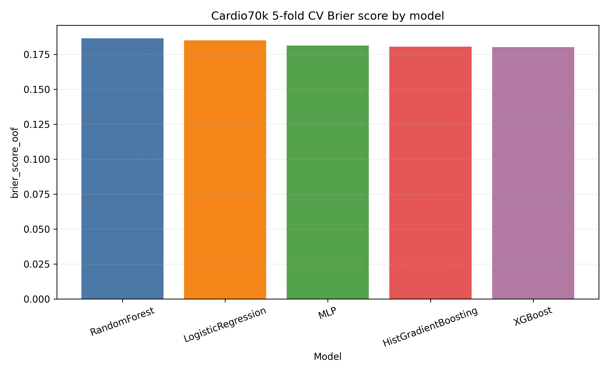
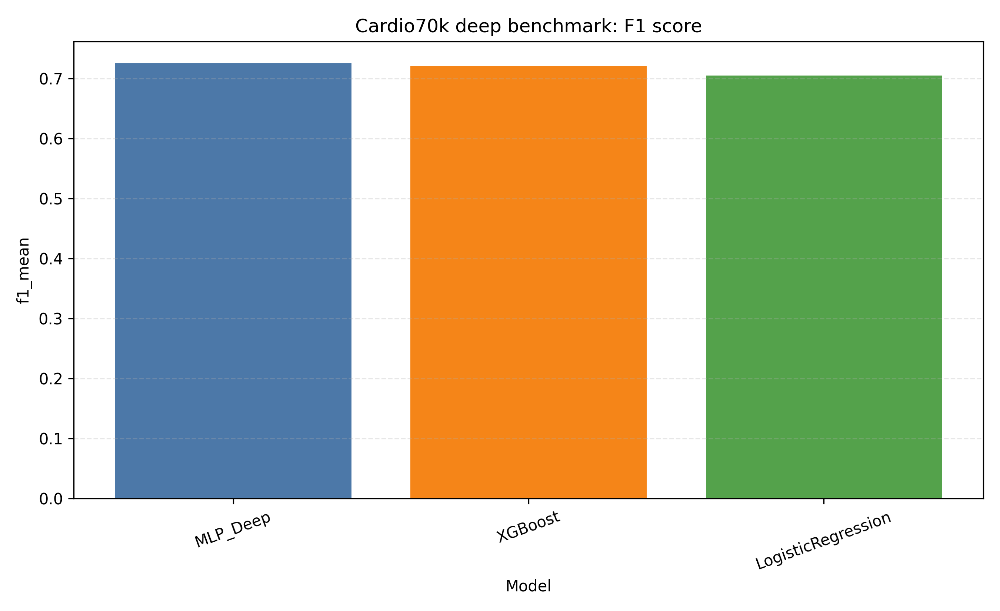
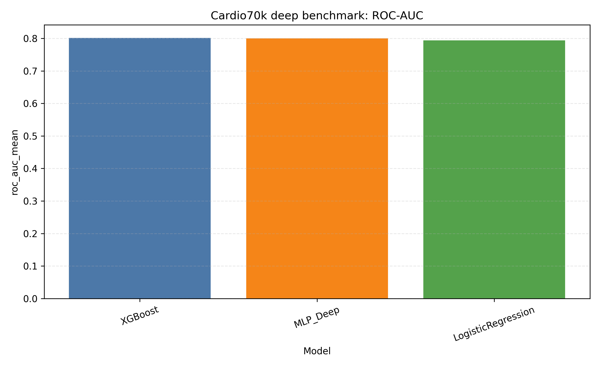
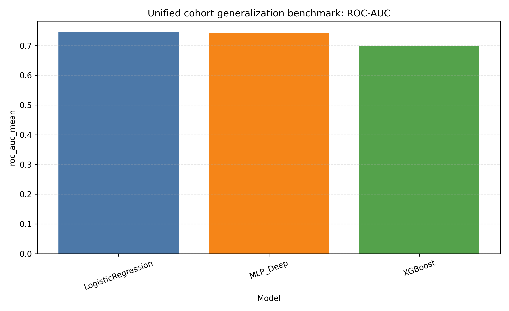
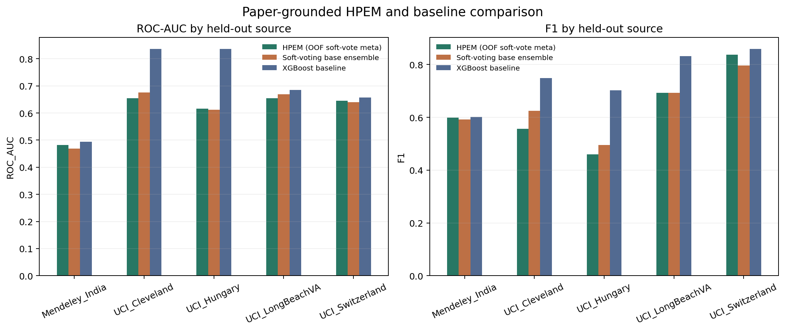
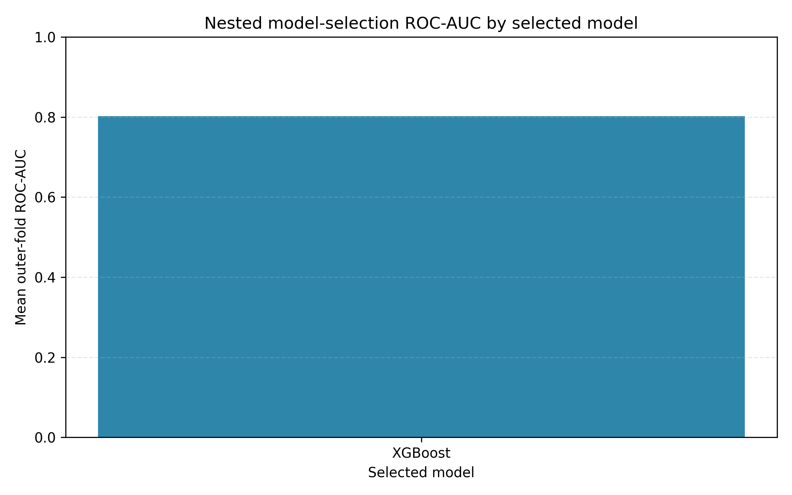

# Cardiovascular Disease Detection: Consolidated Results

## Executive summary

The current evidence supports **XGBoost as the selected internal Cardio70k model**: nested 5-fold model selection chose it in all five outer folds. The source-aware unified-cohort benchmark is a separate stress test, not a pooled validation cohort; its fold variability is substantial. Logistic regression leads by ROC-AUC there, while the deeper MLP baseline leads by mean F1. These findings do not establish clinical readiness or external validity.

## Model selection by task

| Evaluation task | Selected model | Evidence |
| :--- | :--- | :--- |
| Cardio70k nested selection | XGBoost | Selected in 5/5 outer folds; ROC-AUC 0.8019 |
| Cardio70k CV ranking | XGBoost | Highest ROC-AUC: 0.8019 |
| Unified cohort: ROC-AUC | Logistic Regression | Highest mean ROC-AUC: 0.7449; high variability |
| Unified cohort: F1 | MLP (deep) | Highest mean F1: 0.7570; high variability |

## Cardio70k cross-validation

| Model | ROC-AUC | PR-AUC | F1 | Brier |
| :--- | ---: | ---: | ---: | ---: |
| Logistic Regression | 0.7939 | 0.7710 | 0.7047 | 0.1851 |
| MLP | 0.7991 | 0.7788 | 0.7203 | 0.1814 |
| Random Forest | 0.7892 | 0.7731 | 0.7147 | 0.1866 |
| Histogram Gradient Boosting | 0.8009 | 0.7824 | 0.7198 | 0.1806 |
| XGBoost | 0.8019 | 0.7828 | 0.7205 | 0.1802 |

## Nested model selection

| Selected model | Outer folds | ROC-AUC mean | ROC-AUC SD | F1 mean |
| :--- | ---: | ---: | ---: | ---: |
| XGBoost | 5 | 0.8019 | 0.0027 | 0.7205 |

## Deep tabular benchmark: Cardio70k

| Model | ROC-AUC mean | ROC-AUC SD | PR-AUC mean | F1 mean | Brier mean |
| :--- | ---: | ---: | ---: | ---: | ---: |
| Logistic Regression | 0.7938 | 0.0020 | 0.7709 | 0.7046 | 0.1852 |
| MLP (deep) | 0.8001 | 0.0018 | 0.7786 | 0.7252 | 0.1814 |
| XGBoost | 0.8016 | 0.0020 | 0.7824 | 0.7202 | 0.1803 |

## Deep tabular benchmark: unified cohort

| Model | ROC-AUC mean | ROC-AUC SD | PR-AUC mean | F1 mean | Brier mean |
| :--- | ---: | ---: | ---: | ---: | ---: |
| Logistic Regression | 0.7449 | 0.1023 | 0.8234 | 0.7525 | 0.2084 |
| MLP (deep) | 0.7431 | 0.1108 | 0.8254 | 0.7570 | 0.2088 |
| XGBoost | 0.6989 | 0.1475 | 0.7731 | 0.7430 | 0.2071 |

## Probability calibration

Cardio70k XGBoost is close to ideal on pooled out-of-fold predictions (calibration slope 1.0019, 10-bin ECE 0.0024). Calibration degrades on the unified source-held-out aggregate: Logistic Regression slope 0.4375, ECE 0.1336; XGBoost slope 0.3502, ECE 0.1643. Source-specific values vary substantially, so the pooled unified figure should not be read as transportable calibration.

| Cohort | Held-out source | Model | N | Brier | Log loss | Cal. intercept | Cal. slope | ECE (10 bins) |
| ---: | ---: | :--- | ---: | ---: | ---: | ---: | ---: | ---: |
| Cardio70k | All folds | Logistic Regression | 68,581 | 0.1851 | 0.5548 | -0.0002 | 0.9987 | 0.0294 |
| Cardio70k | All folds | XGBoost | 68,581 | 0.1802 | 0.5404 | 0.0002 | 1.0019 | 0.0024 |
| Unified clinical | Mendeley_India | Logistic Regression | 1,000 | 0.2768 | 0.8303 | -0.0192 | 0.2752 | 0.2103 |
| Unified clinical | Mendeley_India | XGBoost | 1,000 | 0.3244 | 0.9317 | 0.3162 | 0.0120 | 0.2665 |
| Unified clinical | UCI_Cleveland | Logistic Regression | 303 | 0.1685 | 0.5167 | -0.4851 | 0.7181 | 0.0965 |
| Unified clinical | UCI_Cleveland | XGBoost | 303 | 0.1722 | 0.5293 | -0.3523 | 0.7083 | 0.0831 |
| Unified clinical | UCI_Hungary | Logistic Regression | 293 | 0.1591 | 0.4894 | -0.7218 | 1.0011 | 0.1096 |
| Unified clinical | UCI_Hungary | XGBoost | 293 | 0.1601 | 0.4945 | -0.3983 | 0.7665 | 0.0668 |
| Unified clinical | UCI_LongBeachVA | Logistic Regression | 199 | 0.1933 | 0.6011 | 0.7555 | 0.4351 | 0.1406 |
| Unified clinical | UCI_LongBeachVA | XGBoost | 199 | 0.1937 | 0.6335 | 0.7343 | 0.3635 | 0.1557 |
| Unified clinical | UCI_Switzerland | Logistic Regression | 123 | 0.2443 | 0.7496 | 2.6950 | 0.3670 | 0.3500 |
| Unified clinical | UCI_Switzerland | XGBoost | 123 | 0.1748 | 0.5444 | 2.4468 | 0.2975 | 0.2700 |
| Unified clinical | All held-out sources | Logistic Regression | 1,918 | 0.2310 | 0.6997 | -0.0607 | 0.4375 | 0.1336 |
| Unified clinical | All held-out sources | XGBoost | 1,918 | 0.2521 | 0.7455 | 0.1478 | 0.3502 | 0.1643 |

See [calibration_analysis.md](calibration_analysis.md) for protocol, interpretation, and the reliability curve.

## Held-out explainability and subgroup analysis

Permutation importance is predictive reliance, not a causal or clinical risk-factor ranking. Cardio70k's leading variables are systolic blood pressure, age, and cholesterol level; unified-cohort importance varies more across held-out sources.

| Cohort | Feature | Mean ROC-AUC decrease | SD across folds/sources | Held-out groups | Rank |
| ---: | ---: | ---: | ---: | ---: | ---: |
| Cardio70k | systolic_bp | 0.1473 | 0.0026 | 5 | 1 |
| Cardio70k | age_years | 0.0371 | 0.0009 | 5 | 2 |
| Cardio70k | cholesterol_level | 0.0298 | 0.0011 | 5 | 3 |
| Cardio70k | bmi | 0.0027 | 0.0003 | 5 | 4 |
| Cardio70k | diastolic_bp | 0.0022 | 0.0003 | 5 | 5 |
| Cardio70k | physically_active | 0.0021 | 0.0003 | 5 | 6 |
| Cardio70k | glucose_level | 0.0017 | 0.0005 | 5 | 7 |
| Cardio70k | weight_kg | 0.0016 | 0.0003 | 5 | 8 |
| Cardio70k | bp_category | 0.0015 | 0.0004 | 5 | 9 |
| Cardio70k | smoking | 0.0007 | 0.0003 | 5 | 10 |
| Unified clinical | chest_pain_type | 0.0682 | 0.0620 | 5 | 1 |
| Unified clinical | exercise_angina | 0.0197 | 0.0173 | 5 | 2 |
| Unified clinical | num_major_vessels | 0.0158 | 0.0359 | 5 | 3 |
| Unified clinical | resting_bp | 0.0120 | 0.0128 | 5 | 4 |
| Unified clinical | thalassemia | 0.0068 | 0.0082 | 5 | 5 |
| Unified clinical | oldpeak | 0.0041 | 0.0254 | 5 | 6 |
| Unified clinical | age | 0.0040 | 0.0037 | 5 | 7 |
| Unified clinical | fasting_blood_sugar | 0.0030 | 0.0056 | 5 | 8 |
| Unified clinical | cholesterol | 0.0022 | 0.0096 | 5 | 9 |
| Unified clinical | sex | 0.0014 | 0.0139 | 5 | 10 |

| Cohort | Group type | Group | N | Sensitivity | Specificity | F1 | ROC-AUC | Brier | Status |
| ---: | ---: | ---: | ---: | ---: | ---: | ---: | ---: | ---: | ---: |
| Cardio70k | Overall | All | 68,581 | 0.6883 | 0.7822 | 0.7205 | 0.8019 | 0.1802 | Reviewable |
| Cardio70k | Sex | Female (code 0) | 44,665 | 0.6899 | 0.7814 | 0.7203 | 0.8036 | 0.1795 | Reviewable |
| Cardio70k | Sex | Male (code 1) | 23,916 | 0.6854 | 0.7838 | 0.7207 | 0.7985 | 0.1816 | Reviewable |
| Cardio70k | Age band | 45-59 | 45,680 | 0.6355 | 0.8094 | 0.6934 | 0.7814 | 0.1879 | Reviewable |
| Cardio70k | Age band | 60+ | 12,812 | 0.8709 | 0.3683 | 0.7967 | 0.7232 | 0.1910 | Reviewable |
| Cardio70k | Age band | <45 | 10,089 | 0.5604 | 0.9411 | 0.6583 | 0.8301 | 0.1319 | Reviewable |
| Unified clinical | Overall | All | 1,918 | 0.7086 | 0.5265 | 0.6847 | 0.6669 | 0.2521 | Reviewable |
| Unified clinical | Source | Mendeley_India | 1,000 | 0.6397 | 0.3286 | 0.6018 | 0.4937 | 0.3244 | Reviewable |
| Unified clinical | Source | UCI_Cleveland | 303 | 0.8058 | 0.7073 | 0.7492 | 0.8358 | 0.1722 | Reviewable |
| Unified clinical | Source | UCI_Hungary | 293 | 0.7358 | 0.7968 | 0.7027 | 0.8370 | 0.1601 | Reviewable |
| Unified clinical | Source | UCI_LongBeachVA | 199 | 0.8176 | 0.5686 | 0.8316 | 0.6848 | 0.1937 | Reviewable |
| Unified clinical | Source | UCI_Switzerland | 123 | 0.7739 | 0.6250 | 0.8599 | 0.6576 | 0.1748 | Small cell: descriptive only |
| Unified clinical | Sex | Female (code 0) | 428 | 0.4481 | 0.8000 | 0.5223 | 0.7334 | 0.2231 | Reviewable |
| Unified clinical | Sex | Male (code 1) | 1,490 | 0.7613 | 0.4120 | 0.7110 | 0.6242 | 0.2605 | Reviewable |
| Unified clinical | Age band | 45-59 | 730 | 0.7440 | 0.5949 | 0.7247 | 0.7429 | 0.2148 | Reviewable |
| Unified clinical | Age band | 60+ | 582 | 0.7748 | 0.3971 | 0.7335 | 0.6170 | 0.2532 | Reviewable |
| Unified clinical | Age band | <45 | 606 | 0.5781 | 0.5443 | 0.5668 | 0.6011 | 0.2961 | Reviewable |

Age/sex/source results are descriptive at a fixed 0.5 threshold. Small cells are flagged; the supplied legend documents sex code 0 as female and 1 as male. This binary biological-sex field does not represent broader gender identities. These are not fairness or clinical utility assessments. See [explainability_error_analysis.md](explainability_error_analysis.md) for methodology and figures.

## HPEM adaptation benchmark

The leakage-safe HPEM adaptation was evaluated on the same five source-held-out folds as the standalone XGBoost baseline. It averaged ROC-AUC 0.6107 and F1 0.6291, below the matched XGBoost baseline (ROC-AUC 0.7018; F1 0.7490). This adaptation differs from the paper's pooled 5-fold setup and is not an exact reproduction.

| Model | Sources | Records | ROC-AUC mean | ROC-AUC SD | F1 mean | F1 SD | Brier mean |
| :--- | ---: | ---: | ---: | ---: | ---: | ---: | ---: |
| HPEM (OOF soft-vote meta) | 5.0000 | 1918.0000 | 0.6107 | 0.0735 | 0.6291 | 0.1434 | 0.2568 |
| Soft-voting base ensemble | 5.0000 | 1918.0000 | 0.6132 | 0.0847 | 0.6404 | 0.1123 | 0.2491 |
| XGBoost baseline | 5.0000 | 1918.0000 | 0.7018 | 0.1430 | 0.7490 | 0.1036 | 0.2050 |

| Held-out source | Model | N | ROC-AUC | F1 | Brier |
| ---: | :--- | ---: | ---: | ---: | ---: |
| Mendeley_India | HPEM (OOF soft-vote meta) | 1000.0000 | 0.4824 | 0.5993 | 0.2871 |
| Mendeley_India | Soft-voting base ensemble | 1000.0000 | 0.4686 | 0.5927 | 0.2993 |
| Mendeley_India | XGBoost baseline | 1000.0000 | 0.4937 | 0.6018 | 0.3244 |
| UCI_Cleveland | HPEM (OOF soft-vote meta) | 303.0000 | 0.6551 | 0.5560 | 0.2381 |
| UCI_Cleveland | Soft-voting base ensemble | 303.0000 | 0.6758 | 0.6246 | 0.2319 |
| UCI_Cleveland | XGBoost baseline | 303.0000 | 0.8358 | 0.7492 | 0.1722 |
| UCI_Hungary | HPEM (OOF soft-vote meta) | 293.0000 | 0.6158 | 0.4601 | 0.2706 |
| UCI_Hungary | Soft-voting base ensemble | 293.0000 | 0.6126 | 0.4957 | 0.2570 |
| UCI_Hungary | XGBoost baseline | 293.0000 | 0.8370 | 0.7027 | 0.1601 |
| UCI_LongBeachVA | HPEM (OOF soft-vote meta) | 199.0000 | 0.6548 | 0.6929 | 0.2831 |
| UCI_LongBeachVA | Soft-voting base ensemble | 199.0000 | 0.6690 | 0.6932 | 0.2512 |
| UCI_LongBeachVA | XGBoost baseline | 199.0000 | 0.6848 | 0.8316 | 0.1937 |
| UCI_Switzerland | HPEM (OOF soft-vote meta) | 123.0000 | 0.6457 | 0.8374 | 0.2050 |
| UCI_Switzerland | Soft-voting base ensemble | 123.0000 | 0.6402 | 0.7959 | 0.2061 |
| UCI_Switzerland | XGBoost baseline | 123.0000 | 0.6576 | 0.8599 | 0.1748 |

See [hpem_benchmark.md](hpem_benchmark.md) for the method and leakage-prevention details.

## Uncertainty and threshold trade-offs

These percentile intervals use 300 stratified bootstrap resamples and are conditional on the observed records, fitted models, split structure, and source mix. They do not quantify model-selection uncertainty or uncertainty over new sources. For unified pooled predictions, Logistic Regression exceeds XGBoost in ROC-AUC by 0.0460 (95% CI 0.0319 to 0.0606); HPEM is below XGBoost by 0.0836 (-0.1053 to -0.0641). Read the paired intervals alongside source-specific results.

| Cohort | Scope | Model | Metric | Estimate | 95% CI low | 95% CI high |
| ---: | ---: | :--- | ---: | ---: | ---: | ---: |
| Cardio70k | All folds | Logistic Regression | roc_auc | 0.7939 | 0.7902 | 0.7972 |
| Cardio70k | All folds | Logistic Regression | pr_auc | 0.7710 | 0.7660 | 0.7749 |
| Cardio70k | All folds | Logistic Regression | accuracy | 0.7292 | 0.7252 | 0.7329 |
| Cardio70k | All folds | Logistic Regression | sensitivity | 0.6530 | 0.6465 | 0.6584 |
| Cardio70k | All folds | Logistic Regression | specificity | 0.8038 | 0.7991 | 0.8076 |
| Cardio70k | All folds | Logistic Regression | f1 | 0.7047 | 0.7002 | 0.7088 |
| Cardio70k | All folds | Logistic Regression | brier_score | 0.1851 | 0.1836 | 0.1868 |
| Cardio70k | All folds | XGBoost | roc_auc | 0.8019 | 0.7979 | 0.8052 |
| Cardio70k | All folds | XGBoost | pr_auc | 0.7828 | 0.7778 | 0.7866 |
| Cardio70k | All folds | XGBoost | accuracy | 0.7358 | 0.7322 | 0.7390 |
| Cardio70k | All folds | XGBoost | sensitivity | 0.6883 | 0.6822 | 0.6932 |
| Cardio70k | All folds | XGBoost | specificity | 0.7822 | 0.7779 | 0.7863 |
| Cardio70k | All folds | XGBoost | f1 | 0.7205 | 0.7163 | 0.7241 |
| Cardio70k | All folds | XGBoost | brier_score | 0.1802 | 0.1786 | 0.1821 |
| Unified clinical | All sources | HPEM (OOF soft-vote meta) | roc_auc | 0.5833 | 0.5592 | 0.6088 |
| Unified clinical | All sources | HPEM (OOF soft-vote meta) | pr_auc | 0.6307 | 0.6073 | 0.6562 |
| Unified clinical | All sources | HPEM (OOF soft-vote meta) | accuracy | 0.5699 | 0.5501 | 0.5900 |
| Unified clinical | All sources | HPEM (OOF soft-vote meta) | sensitivity | 0.6020 | 0.5712 | 0.6305 |
| Unified clinical | All sources | HPEM (OOF soft-vote meta) | specificity | 0.5277 | 0.4982 | 0.5615 |
| Unified clinical | All sources | HPEM (OOF soft-vote meta) | f1 | 0.6136 | 0.5922 | 0.6344 |
| Unified clinical | All sources | HPEM (OOF soft-vote meta) | brier_score | 0.2712 | 0.2607 | 0.2818 |
| Unified clinical | All sources | XGBoost | roc_auc | 0.6669 | 0.6443 | 0.6861 |
| Unified clinical | All sources | XGBoost | pr_auc | 0.6975 | 0.6736 | 0.7181 |
| Unified clinical | All sources | XGBoost | accuracy | 0.6298 | 0.6082 | 0.6465 |
| Unified clinical | All sources | XGBoost | sensitivity | 0.7086 | 0.6838 | 0.7330 |
| Unified clinical | All sources | XGBoost | specificity | 0.5265 | 0.4976 | 0.5554 |
| Unified clinical | All sources | XGBoost | f1 | 0.6847 | 0.6643 | 0.7005 |
| Unified clinical | All sources | XGBoost | brier_score | 0.2521 | 0.2426 | 0.2643 |
| Unified clinical | All sources | Logistic Regression | roc_auc | 0.7130 | 0.6902 | 0.7343 |
| Unified clinical | All sources | Logistic Regression | pr_auc | 0.7496 | 0.7278 | 0.7732 |
| Unified clinical | All sources | Logistic Regression | accuracy | 0.6606 | 0.6423 | 0.6770 |
| Unified clinical | All sources | Logistic Regression | sensitivity | 0.7941 | 0.7702 | 0.8171 |
| Unified clinical | All sources | Logistic Regression | specificity | 0.4855 | 0.4566 | 0.5145 |
| Unified clinical | All sources | Logistic Regression | f1 | 0.7264 | 0.7101 | 0.7395 |
| Unified clinical | All sources | Logistic Regression | brier_score | 0.2310 | 0.2205 | 0.2427 |

| Cohort | Scope | First minus second | Metric | Difference | 95% CI low | 95% CI high |
| ---: | ---: | ---: | ---: | ---: | ---: | ---: |
| Cardio70k | All folds | LogisticRegression minus XGBoost | roc_auc | -0.0079 | -0.0090 | -0.0070 |
| Cardio70k | All folds | LogisticRegression minus XGBoost | pr_auc | -0.0118 | -0.0147 | -0.0088 |
| Cardio70k | All folds | LogisticRegression minus XGBoost | accuracy | -0.0065 | -0.0083 | -0.0047 |
| Cardio70k | All folds | LogisticRegression minus XGBoost | sensitivity | -0.0353 | -0.0378 | -0.0326 |
| Cardio70k | All folds | LogisticRegression minus XGBoost | specificity | 0.0216 | 0.0193 | 0.0242 |
| Cardio70k | All folds | LogisticRegression minus XGBoost | f1 | -0.0158 | -0.0178 | -0.0136 |
| Cardio70k | All folds | LogisticRegression minus XGBoost | brier_score | 0.0049 | 0.0044 | 0.0054 |
| Unified clinical | All sources | HPEM (OOF soft-vote meta) minus XGBoost | roc_auc | -0.0836 | -0.1053 | -0.0641 |
| Unified clinical | All sources | HPEM (OOF soft-vote meta) minus XGBoost | pr_auc | -0.0667 | -0.0879 | -0.0489 |
| Unified clinical | All sources | HPEM (OOF soft-vote meta) minus XGBoost | accuracy | -0.0600 | -0.0835 | -0.0406 |
| Unified clinical | All sources | HPEM (OOF soft-vote meta) minus XGBoost | sensitivity | -0.1066 | -0.1342 | -0.0767 |
| Unified clinical | All sources | HPEM (OOF soft-vote meta) minus XGBoost | specificity | 0.0012 | -0.0337 | 0.0313 |
| Unified clinical | All sources | HPEM (OOF soft-vote meta) minus XGBoost | f1 | -0.0711 | -0.0936 | -0.0521 |
| Unified clinical | All sources | HPEM (OOF soft-vote meta) minus XGBoost | brier_score | 0.0190 | 0.0092 | 0.0289 |
| Unified clinical | All sources | LogisticRegression minus XGBoost | roc_auc | 0.0460 | 0.0319 | 0.0606 |
| Unified clinical | All sources | LogisticRegression minus XGBoost | pr_auc | 0.0521 | 0.0337 | 0.0735 |
| Unified clinical | All sources | LogisticRegression minus XGBoost | accuracy | 0.0308 | 0.0135 | 0.0467 |
| Unified clinical | All sources | LogisticRegression minus XGBoost | sensitivity | 0.0855 | 0.0625 | 0.1089 |
| Unified clinical | All sources | LogisticRegression minus XGBoost | specificity | -0.0410 | -0.0669 | -0.0150 |
| Unified clinical | All sources | LogisticRegression minus XGBoost | f1 | 0.0416 | 0.0255 | 0.0564 |
| Unified clinical | All sources | LogisticRegression minus XGBoost | brier_score | -0.0212 | -0.0300 | -0.0137 |

Threshold profiles show the sensitivity/specificity trade-off only; no clinical cutoff is selected because the intended action and relative error costs have not been defined.

| Cohort | Scope | Model | Threshold | Sensitivity | Specificity | Precision | Predicted positive rate | FP | FN |
| ---: | ---: | :--- | ---: | ---: | ---: | ---: | ---: | ---: | ---: |
| Cardio70k | All folds | Logistic Regression | 0.3000 | 0.8971 | 0.4373 | 0.6095 | 0.7281 | 19499.0000 | 3491.0000 |
| Cardio70k | All folds | Logistic Regression | 0.5000 | 0.6530 | 0.8038 | 0.7652 | 0.4222 | 6798.0000 | 11773.0000 |
| Cardio70k | All folds | Logistic Regression | 0.7000 | 0.4664 | 0.9043 | 0.8267 | 0.2791 | 3317.0000 | 18104.0000 |
| Cardio70k | All folds | XGBoost | 0.3000 | 0.8786 | 0.4917 | 0.6286 | 0.6915 | 17613.0000 | 4118.0000 |
| Cardio70k | All folds | XGBoost | 0.5000 | 0.6883 | 0.7822 | 0.7558 | 0.4505 | 7546.0000 | 10576.0000 |
| Cardio70k | All folds | XGBoost | 0.7000 | 0.5240 | 0.8944 | 0.8293 | 0.3126 | 3659.0000 | 16151.0000 |
| Unified clinical | All held-out sources | HPEM (OOF soft-vote meta) | 0.3000 | 0.7904 | 0.3253 | 0.6056 | 0.7404 | 560.0000 | 228.0000 |
| Unified clinical | All held-out sources | HPEM (OOF soft-vote meta) | 0.5000 | 0.6020 | 0.5277 | 0.6256 | 0.5459 | 392.0000 | 433.0000 |
| Unified clinical | All held-out sources | HPEM (OOF soft-vote meta) | 0.7000 | 0.2279 | 0.8422 | 0.6544 | 0.1976 | 131.0000 | 840.0000 |
| Unified clinical | All held-out sources | XGBoost | 0.3000 | 0.8410 | 0.3892 | 0.6435 | 0.7414 | 507.0000 | 173.0000 |
| Unified clinical | All held-out sources | XGBoost | 0.5000 | 0.7086 | 0.5265 | 0.6624 | 0.6069 | 393.0000 | 317.0000 |
| Unified clinical | All held-out sources | XGBoost | 0.7000 | 0.5312 | 0.6771 | 0.6832 | 0.4411 | 268.0000 | 510.0000 |
| Unified clinical | All held-out sources | Logistic Regression | 0.3000 | 0.9035 | 0.3181 | 0.6346 | 0.8076 | 566.0000 | 105.0000 |
| Unified clinical | All held-out sources | Logistic Regression | 0.5000 | 0.7941 | 0.4855 | 0.6692 | 0.6731 | 427.0000 | 224.0000 |
| Unified clinical | All held-out sources | Logistic Regression | 0.7000 | 0.6599 | 0.6614 | 0.7187 | 0.5209 | 281.0000 | 370.0000 |

See [uncertainty_threshold_analysis.md](uncertainty_threshold_analysis.md) for the full source-specific intervals and threshold profiles.

## Research status

Completed: data audit, quality analysis, baseline and deep-tabular benchmarks, internal cross-validation, nested model selection, source-held-out stress testing, results visualization, probability calibration, held-out permutation importance, exploratory subgroup/error analysis, leakage-safe HPEM adaptation, conditional bootstrap uncertainty, and threshold trade-off analysis.

Remaining: independent external validation, subgroup uncertainty intervals, prespecified clinical-utility analysis with expert input, and exact HPEM reproduction on matched paper datasets/protocol or multimodal work supported by valid linked data. The present results are research benchmarks, not evidence of clinical readiness.

## Figures

### Calibration Curves

### Cv Brier Score

### Cv Roc Auc

### Deep Cardio F1

### Deep Cardio Roc Auc

### Deep Unified Roc Auc

### Hpem Source Comparison

### Nested Selection Roc Auc

### Permutation Importance

### Subgroup Performance

### Threshold Tradeoffs

## Interpretation and limitations

- Cohorts remain separate because dataset provenance and patient linkage do not support a scientifically valid pooled multimodal claim.
- The unified-cohort metrics have high fold-to-fold variation; report them as a source-shift stress test, not as a stable estimate of deployment performance.
- Discrimination (ROC-AUC/PR-AUC), threshold metrics (sensitivity, specificity, F1), and probability calibration (Brier score) answer different questions. Model choice should be tied to the intended clinical use and validated threshold.
- All selected models are research benchmarks, not diagnostic devices. Independent external validation, uncertainty/utility analysis, and clinical review remain necessary before clinical interpretation.
- Scores in this report are taken directly from the generated CSV outputs; differences between the CV, nested, and deep benchmark scripts may reflect their evaluation implementations and should not be treated as identical experiments.
