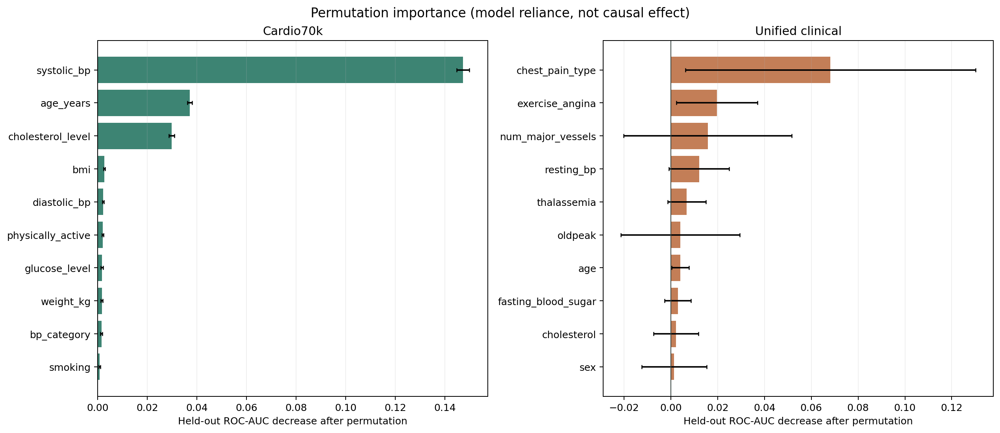
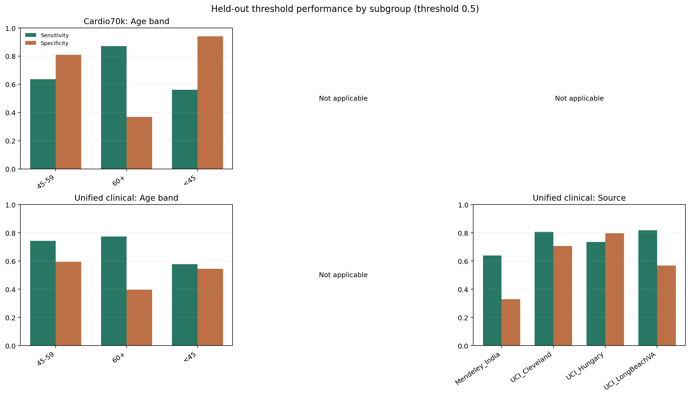

# Held-out Explainability and Error Analysis

## Protocol

XGBoost was evaluated using Cardio70k stratified 5-fold out-of-fold predictions and unified-cohort leave-one-source-out predictions. Permutation importance was measured on each held-out fold/source using ROC-AUC decrease, then summarized across held-out units. Group metrics use the same held-out probabilities and a fixed 0.5 threshold. Age bands are <45, 45-59, and 60+. The supplied dataset legend documents the binary sex field as 0=female and 1=male; this coding does not represent a broader set of gender identities.

## Permutation importance

| cohort           | feature             | importance_mean | importance_sd_across_held_out | held_out_groups | rank_within_cohort |
| ---------------- | ------------------- | --------------- | ----------------------------- | --------------- | ------------------ |
| Cardio70k        | systolic_bp         | 0.1473          | 0.0026                        | 5               | 1                  |
| Cardio70k        | age_years           | 0.0371          | 0.0009                        | 5               | 2                  |
| Cardio70k        | cholesterol_level   | 0.0298          | 0.0011                        | 5               | 3                  |
| Cardio70k        | bmi                 | 0.0027          | 0.0003                        | 5               | 4                  |
| Cardio70k        | diastolic_bp        | 0.0022          | 0.0003                        | 5               | 5                  |
| Cardio70k        | physically_active   | 0.0021          | 0.0003                        | 5               | 6                  |
| Cardio70k        | glucose_level       | 0.0017          | 0.0005                        | 5               | 7                  |
| Cardio70k        | weight_kg           | 0.0016          | 0.0003                        | 5               | 8                  |
| Cardio70k        | bp_category         | 0.0015          | 0.0004                        | 5               | 9                  |
| Cardio70k        | smoking             | 0.0007          | 0.0003                        | 5               | 10                 |
| Unified clinical | chest_pain_type     | 0.0682          | 0.0620                        | 5               | 1                  |
| Unified clinical | exercise_angina     | 0.0197          | 0.0173                        | 5               | 2                  |
| Unified clinical | num_major_vessels   | 0.0158          | 0.0359                        | 5               | 3                  |
| Unified clinical | resting_bp          | 0.0120          | 0.0128                        | 5               | 4                  |
| Unified clinical | thalassemia         | 0.0068          | 0.0082                        | 5               | 5                  |
| Unified clinical | oldpeak             | 0.0041          | 0.0254                        | 5               | 6                  |
| Unified clinical | age                 | 0.0040          | 0.0037                        | 5               | 7                  |
| Unified clinical | fasting_blood_sugar | 0.0030          | 0.0056                        | 5               | 8                  |
| Unified clinical | cholesterol         | 0.0022          | 0.0096                        | 5               | 9                  |
| Unified clinical | sex                 | 0.0014          | 0.0139                        | 5               | 10                 |

Permutation importance estimates how much this fitted model relies on a feature for ranking performance in these evaluation folds. It is not a causal effect, a clinical risk factor ranking, or proof of independent feature value. Correlated predictors can share or mask importance; source-specific importance can vary.

## Subgroup and source error metrics

| cohort           | group_type | group           | n     | positive_n | sensitivity | specificity | precision | f1    | roc_auc | brier_score | interpretation_status        |
| ---------------- | ---------- | --------------- | ----- | ---------- | ----------- | ----------- | --------- | ----- | ------- | ----------- | ---------------------------- |
| Cardio70k        | Overall    | All             | 68581 | 33929      | 0.688       | 0.782       | 0.756     | 0.720 | 0.802   | 0.180       | Reviewable                   |
| Cardio70k        | Sex        | Female (code 0) | 44665 | 21981      | 0.690       | 0.781       | 0.754     | 0.720 | 0.804   | 0.180       | Reviewable                   |
| Cardio70k        | Sex        | Male (code 1)   | 23916 | 11948      | 0.685       | 0.784       | 0.760     | 0.721 | 0.798   | 0.182       | Reviewable                   |
| Cardio70k        | Age band   | 45-59           | 45680 | 22430      | 0.636       | 0.809       | 0.763     | 0.693 | 0.781   | 0.188       | Reviewable                   |
| Cardio70k        | Age band   | 60+             | 12812 | 8546       | 0.871       | 0.368       | 0.734     | 0.797 | 0.723   | 0.191       | Reviewable                   |
| Cardio70k        | Age band   | <45             | 10089 | 2953       | 0.560       | 0.941       | 0.798     | 0.658 | 0.830   | 0.132       | Reviewable                   |
| Unified clinical | Overall    | All             | 1918  | 1088       | 0.709       | 0.527       | 0.662     | 0.685 | 0.667   | 0.252       | Reviewable                   |
| Unified clinical | Source     | Mendeley_India  | 1000  | 580        | 0.640       | 0.329       | 0.568     | 0.602 | 0.494   | 0.324       | Reviewable                   |
| Unified clinical | Source     | UCI_Cleveland   | 303   | 139        | 0.806       | 0.707       | 0.700     | 0.749 | 0.836   | 0.172       | Reviewable                   |
| Unified clinical | Source     | UCI_Hungary     | 293   | 106        | 0.736       | 0.797       | 0.672     | 0.703 | 0.837   | 0.160       | Reviewable                   |
| Unified clinical | Source     | UCI_LongBeachVA | 199   | 148        | 0.818       | 0.569       | 0.846     | 0.832 | 0.685   | 0.194       | Reviewable                   |
| Unified clinical | Source     | UCI_Switzerland | 123   | 115        | 0.774       | 0.625       | 0.967     | 0.860 | 0.658   | 0.175       | Small cell: descriptive only |
| Unified clinical | Sex        | Female (code 0) | 428   | 183        | 0.448       | 0.800       | 0.626     | 0.522 | 0.733   | 0.223       | Reviewable                   |
| Unified clinical | Sex        | Male (code 1)   | 1490  | 905        | 0.761       | 0.412       | 0.667     | 0.711 | 0.624   | 0.260       | Reviewable                   |
| Unified clinical | Age band   | 45-59           | 730   | 414        | 0.744       | 0.595       | 0.706     | 0.725 | 0.743   | 0.215       | Reviewable                   |
| Unified clinical | Age band   | 60+             | 582   | 373        | 0.775       | 0.397       | 0.696     | 0.734 | 0.617   | 0.253       | Reviewable                   |
| Unified clinical | Age band   | <45             | 606   | 301        | 0.578       | 0.544       | 0.556     | 0.567 | 0.601   | 0.296       | Reviewable                   |

Rows marked `Small cell: descriptive only` have fewer than the configured minimum observations or fewer than 20 examples in either class and should not support comparative claims. These subgroup analyses are exploratory, unadjusted, and not fairness certification. Unified-cohort strata combine heterogeneous sources unless a row explicitly identifies a source; source-level results should be considered alongside subgroup results.

## Remaining research

Independent external validation, confidence intervals for subgroup metrics, threshold selection tied to a defined use case, and a protocol-grounded reproduction of the foundation-paper HPEM remain open. No clinical utility or deployment claim is supported by these experiments.

Files: `permutation_importance_summary.csv`, `permutation_importance_by_holdout.csv`, and `subgroup_error_metrics.csv`.
