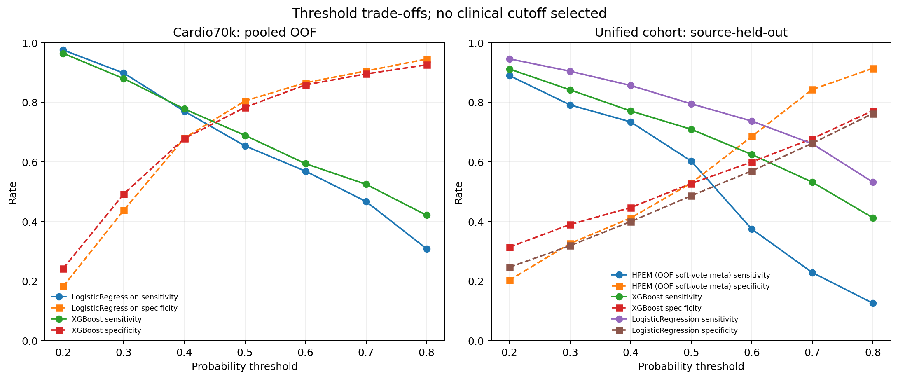

# Uncertainty and Threshold Analysis

## Protocol

Cardio70k estimates use 5-fold out-of-fold predictions for Logistic Regression and XGBoost. Unified-cohort estimates use the saved leave-one-source-out predictions for HPEM and XGBoost and newly generated leave-one-source-out Logistic Regression predictions. Confidence intervals are percentile intervals from 300 stratified bootstrap resamples. Cardio70k resampling preserves the observed outcome counts; unified resampling preserves each source-by-outcome cell and therefore conditions on the observed source mix and prevalence. Comparisons use paired resamples of the same records.

These intervals quantify sampling variability conditional on these datasets, splits, fitted pipelines, and observed source composition. They do not account for model-selection uncertainty, source-population uncertainty, or external transport. Five sources are not enough to estimate uncertainty over a population of sources.

## Held-out metric estimates with conditional 95% intervals

| cohort           | scope           | model                     | n     | metric      | estimate | ci_95_lower | ci_95_upper |
| ---------------- | --------------- | ------------------------- | ----- | ----------- | -------- | ----------- | ----------- |
| Cardio70k        | All folds       | LogisticRegression        | 68581 | roc_auc     | 0.7939   | 0.7902      | 0.7972      |
| Cardio70k        | All folds       | LogisticRegression        | 68581 | pr_auc      | 0.7710   | 0.7660      | 0.7749      |
| Cardio70k        | All folds       | LogisticRegression        | 68581 | accuracy    | 0.7292   | 0.7252      | 0.7329      |
| Cardio70k        | All folds       | LogisticRegression        | 68581 | sensitivity | 0.6530   | 0.6465      | 0.6584      |
| Cardio70k        | All folds       | LogisticRegression        | 68581 | specificity | 0.8038   | 0.7991      | 0.8076      |
| Cardio70k        | All folds       | LogisticRegression        | 68581 | f1          | 0.7047   | 0.7002      | 0.7088      |
| Cardio70k        | All folds       | LogisticRegression        | 68581 | brier_score | 0.1851   | 0.1836      | 0.1868      |
| Cardio70k        | All folds       | XGBoost                   | 68581 | roc_auc     | 0.8019   | 0.7979      | 0.8052      |
| Cardio70k        | All folds       | XGBoost                   | 68581 | pr_auc      | 0.7828   | 0.7778      | 0.7866      |
| Cardio70k        | All folds       | XGBoost                   | 68581 | accuracy    | 0.7358   | 0.7322      | 0.7390      |
| Cardio70k        | All folds       | XGBoost                   | 68581 | sensitivity | 0.6883   | 0.6822      | 0.6932      |
| Cardio70k        | All folds       | XGBoost                   | 68581 | specificity | 0.7822   | 0.7779      | 0.7863      |
| Cardio70k        | All folds       | XGBoost                   | 68581 | f1          | 0.7205   | 0.7163      | 0.7241      |
| Cardio70k        | All folds       | XGBoost                   | 68581 | brier_score | 0.1802   | 0.1786      | 0.1821      |
| Unified clinical | All sources     | HPEM (OOF soft-vote meta) | 1918  | roc_auc     | 0.5833   | 0.5592      | 0.6088      |
| Unified clinical | All sources     | HPEM (OOF soft-vote meta) | 1918  | pr_auc      | 0.6307   | 0.6073      | 0.6562      |
| Unified clinical | All sources     | HPEM (OOF soft-vote meta) | 1918  | accuracy    | 0.5699   | 0.5501      | 0.5900      |
| Unified clinical | All sources     | HPEM (OOF soft-vote meta) | 1918  | sensitivity | 0.6020   | 0.5712      | 0.6305      |
| Unified clinical | All sources     | HPEM (OOF soft-vote meta) | 1918  | specificity | 0.5277   | 0.4982      | 0.5615      |
| Unified clinical | All sources     | HPEM (OOF soft-vote meta) | 1918  | f1          | 0.6136   | 0.5922      | 0.6344      |
| Unified clinical | All sources     | HPEM (OOF soft-vote meta) | 1918  | brier_score | 0.2712   | 0.2607      | 0.2818      |
| Unified clinical | All sources     | XGBoost                   | 1918  | roc_auc     | 0.6669   | 0.6443      | 0.6861      |
| Unified clinical | All sources     | XGBoost                   | 1918  | pr_auc      | 0.6975   | 0.6736      | 0.7181      |
| Unified clinical | All sources     | XGBoost                   | 1918  | accuracy    | 0.6298   | 0.6082      | 0.6465      |
| Unified clinical | All sources     | XGBoost                   | 1918  | sensitivity | 0.7086   | 0.6838      | 0.7330      |
| Unified clinical | All sources     | XGBoost                   | 1918  | specificity | 0.5265   | 0.4976      | 0.5554      |
| Unified clinical | All sources     | XGBoost                   | 1918  | f1          | 0.6847   | 0.6643      | 0.7005      |
| Unified clinical | All sources     | XGBoost                   | 1918  | brier_score | 0.2521   | 0.2426      | 0.2643      |
| Unified clinical | All sources     | LogisticRegression        | 1918  | roc_auc     | 0.7130   | 0.6902      | 0.7343      |
| Unified clinical | All sources     | LogisticRegression        | 1918  | pr_auc      | 0.7496   | 0.7278      | 0.7732      |
| Unified clinical | All sources     | LogisticRegression        | 1918  | accuracy    | 0.6606   | 0.6423      | 0.6770      |
| Unified clinical | All sources     | LogisticRegression        | 1918  | sensitivity | 0.7941   | 0.7702      | 0.8171      |
| Unified clinical | All sources     | LogisticRegression        | 1918  | specificity | 0.4855   | 0.4566      | 0.5145      |
| Unified clinical | All sources     | LogisticRegression        | 1918  | f1          | 0.7264   | 0.7101      | 0.7395      |
| Unified clinical | All sources     | LogisticRegression        | 1918  | brier_score | 0.2310   | 0.2205      | 0.2427      |
| Unified clinical | Mendeley_India  | HPEM (OOF soft-vote meta) | 1000  | roc_auc     | 0.4824   | 0.4439      | 0.5175      |
| Unified clinical | Mendeley_India  | HPEM (OOF soft-vote meta) | 1000  | pr_auc      | 0.5617   | 0.5336      | 0.5911      |
| Unified clinical | Mendeley_India  | HPEM (OOF soft-vote meta) | 1000  | accuracy    | 0.5240   | 0.4930      | 0.5505      |
| Unified clinical | Mendeley_India  | HPEM (OOF soft-vote meta) | 1000  | sensitivity | 0.6138   | 0.5759      | 0.6509      |
| Unified clinical | Mendeley_India  | HPEM (OOF soft-vote meta) | 1000  | specificity | 0.4000   | 0.3524      | 0.4476      |
| Unified clinical | Mendeley_India  | HPEM (OOF soft-vote meta) | 1000  | f1          | 0.5993   | 0.5715      | 0.6257      |
| Unified clinical | Mendeley_India  | HPEM (OOF soft-vote meta) | 1000  | brier_score | 0.2871   | 0.2757      | 0.2993      |
| Unified clinical | Mendeley_India  | XGBoost                   | 1000  | roc_auc     | 0.4937   | 0.4540      | 0.5250      |
| Unified clinical | Mendeley_India  | XGBoost                   | 1000  | pr_auc      | 0.5703   | 0.5447      | 0.5996      |
| Unified clinical | Mendeley_India  | XGBoost                   | 1000  | accuracy    | 0.5090   | 0.4805      | 0.5365      |
| Unified clinical | Mendeley_India  | XGBoost                   | 1000  | sensitivity | 0.6397   | 0.6025      | 0.6776      |
| Unified clinical | Mendeley_India  | XGBoost                   | 1000  | specificity | 0.3286   | 0.2868      | 0.3714      |
| Unified clinical | Mendeley_India  | XGBoost                   | 1000  | f1          | 0.6018   | 0.5760      | 0.6268      |
| Unified clinical | Mendeley_India  | XGBoost                   | 1000  | brier_score | 0.3244   | 0.3088      | 0.3424      |
| Unified clinical | Mendeley_India  | LogisticRegression        | 1000  | roc_auc     | 0.6291   | 0.5943      | 0.6642      |
| Unified clinical | Mendeley_India  | LogisticRegression        | 1000  | pr_auc      | 0.7038   | 0.6730      | 0.7345      |
| Unified clinical | Mendeley_India  | LogisticRegression        | 1000  | accuracy    | 0.5860   | 0.5620      | 0.6105      |
| Unified clinical | Mendeley_India  | LogisticRegression        | 1000  | sensitivity | 0.8190   | 0.7897      | 0.8484      |
| Unified clinical | Mendeley_India  | LogisticRegression        | 1000  | specificity | 0.2643   | 0.2286      | 0.3073      |
| Unified clinical | Mendeley_India  | LogisticRegression        | 1000  | f1          | 0.6965   | 0.6777      | 0.7159      |
| Unified clinical | Mendeley_India  | LogisticRegression        | 1000  | brier_score | 0.2768   | 0.2603      | 0.2923      |
| Unified clinical | UCI_Cleveland   | HPEM (OOF soft-vote meta) | 303   | roc_auc     | 0.6551   | 0.5926      | 0.7209      |
| Unified clinical | UCI_Cleveland   | HPEM (OOF soft-vote meta) | 303   | pr_auc      | 0.6212   | 0.5634      | 0.6931      |
| Unified clinical | UCI_Cleveland   | HPEM (OOF soft-vote meta) | 303   | accuracy    | 0.5941   | 0.5428      | 0.6502      |
| Unified clinical | UCI_Cleveland   | HPEM (OOF soft-vote meta) | 303   | sensitivity | 0.5540   | 0.4820      | 0.6331      |
| Unified clinical | UCI_Cleveland   | HPEM (OOF soft-vote meta) | 303   | specificity | 0.6280   | 0.5488      | 0.7012      |
| Unified clinical | UCI_Cleveland   | HPEM (OOF soft-vote meta) | 303   | f1          | 0.5560   | 0.4961      | 0.6222      |
| Unified clinical | UCI_Cleveland   | HPEM (OOF soft-vote meta) | 303   | brier_score | 0.2381   | 0.2124      | 0.2608      |
| Unified clinical | UCI_Cleveland   | XGBoost                   | 303   | roc_auc     | 0.8358   | 0.7975      | 0.8795      |
| Unified clinical | UCI_Cleveland   | XGBoost                   | 303   | pr_auc      | 0.8203   | 0.7728      | 0.8687      |
| Unified clinical | UCI_Cleveland   | XGBoost                   | 303   | accuracy    | 0.7525   | 0.7111      | 0.7954      |
| Unified clinical | UCI_Cleveland   | XGBoost                   | 303   | sensitivity | 0.8058   | 0.7372      | 0.8705      |
| Unified clinical | UCI_Cleveland   | XGBoost                   | 303   | specificity | 0.7073   | 0.6463      | 0.7744      |
| Unified clinical | UCI_Cleveland   | XGBoost                   | 303   | f1          | 0.7492   | 0.7089      | 0.7934      |
| Unified clinical | UCI_Cleveland   | XGBoost                   | 303   | brier_score | 0.1722   | 0.1480      | 0.1953      |
| Unified clinical | UCI_Cleveland   | LogisticRegression        | 303   | roc_auc     | 0.8491   | 0.8030      | 0.8897      |
| Unified clinical | UCI_Cleveland   | LogisticRegression        | 303   | pr_auc      | 0.8408   | 0.7913      | 0.8860      |
| Unified clinical | UCI_Cleveland   | LogisticRegression        | 303   | accuracy    | 0.7492   | 0.6979      | 0.7971      |
| Unified clinical | UCI_Cleveland   | LogisticRegression        | 303   | sensitivity | 0.8058   | 0.7482      | 0.8705      |
| Unified clinical | UCI_Cleveland   | LogisticRegression        | 303   | specificity | 0.7012   | 0.6402      | 0.7683      |
| Unified clinical | UCI_Cleveland   | LogisticRegression        | 303   | f1          | 0.7467   | 0.6991      | 0.7967      |
| Unified clinical | UCI_Cleveland   | LogisticRegression        | 303   | brier_score | 0.1685   | 0.1427      | 0.1948      |
| Unified clinical | UCI_Hungary     | HPEM (OOF soft-vote meta) | 293   | roc_auc     | 0.6158   | 0.5547      | 0.6817      |
| Unified clinical | UCI_Hungary     | HPEM (OOF soft-vote meta) | 293   | pr_auc      | 0.4548   | 0.4008      | 0.5354      |
| Unified clinical | UCI_Hungary     | HPEM (OOF soft-vote meta) | 293   | accuracy    | 0.6075   | 0.5563      | 0.6605      |
| Unified clinical | UCI_Hungary     | HPEM (OOF soft-vote meta) | 293   | sensitivity | 0.4623   | 0.3724      | 0.5521      |
| Unified clinical | UCI_Hungary     | HPEM (OOF soft-vote meta) | 293   | specificity | 0.6898   | 0.6257      | 0.7433      |
| Unified clinical | UCI_Hungary     | HPEM (OOF soft-vote meta) | 293   | f1          | 0.4601   | 0.3863      | 0.5395      |
| Unified clinical | UCI_Hungary     | HPEM (OOF soft-vote meta) | 293   | brier_score | 0.2706   | 0.2379      | 0.3001      |
| Unified clinical | UCI_Hungary     | XGBoost                   | 293   | roc_auc     | 0.8370   | 0.7900      | 0.8787      |
| Unified clinical | UCI_Hungary     | XGBoost                   | 293   | pr_auc      | 0.7407   | 0.6602      | 0.8186      |
| Unified clinical | UCI_Hungary     | XGBoost                   | 293   | accuracy    | 0.7747   | 0.7304      | 0.8191      |
| Unified clinical | UCI_Hungary     | XGBoost                   | 293   | sensitivity | 0.7358   | 0.6509      | 0.8113      |
| Unified clinical | UCI_Hungary     | XGBoost                   | 293   | specificity | 0.7968   | 0.7433      | 0.8503      |
| Unified clinical | UCI_Hungary     | XGBoost                   | 293   | f1          | 0.7027   | 0.6440      | 0.7638      |
| Unified clinical | UCI_Hungary     | XGBoost                   | 293   | brier_score | 0.1601   | 0.1353      | 0.1847      |
| Unified clinical | UCI_Hungary     | LogisticRegression        | 293   | roc_auc     | 0.8553   | 0.8123      | 0.8956      |
| Unified clinical | UCI_Hungary     | LogisticRegression        | 293   | pr_auc      | 0.7735   | 0.6943      | 0.8443      |
| Unified clinical | UCI_Hungary     | LogisticRegression        | 293   | accuracy    | 0.7952   | 0.7577      | 0.8430      |
| Unified clinical | UCI_Hungary     | LogisticRegression        | 293   | sensitivity | 0.8302   | 0.7547      | 0.8962      |
| Unified clinical | UCI_Hungary     | LogisticRegression        | 293   | specificity | 0.7754   | 0.7245      | 0.8342      |
| Unified clinical | UCI_Hungary     | LogisticRegression        | 293   | f1          | 0.7458   | 0.7013      | 0.8000      |
| Unified clinical | UCI_Hungary     | LogisticRegression        | 293   | brier_score | 0.1591   | 0.1363      | 0.1812      |
| Unified clinical | UCI_LongBeachVA | HPEM (OOF soft-vote meta) | 199   | roc_auc     | 0.6548   | 0.5558      | 0.7496      |
| Unified clinical | UCI_LongBeachVA | HPEM (OOF soft-vote meta) | 199   | pr_auc      | 0.8079   | 0.7515      | 0.8778      |
| Unified clinical | UCI_LongBeachVA | HPEM (OOF soft-vote meta) | 199   | accuracy    | 0.6080   | 0.5377      | 0.6710      |
| Unified clinical | UCI_LongBeachVA | HPEM (OOF soft-vote meta) | 199   | sensitivity | 0.5946   | 0.5135      | 0.6689      |
| Unified clinical | UCI_LongBeachVA | HPEM (OOF soft-vote meta) | 199   | specificity | 0.6471   | 0.5294      | 0.7647      |
| Unified clinical | UCI_LongBeachVA | HPEM (OOF soft-vote meta) | 199   | f1          | 0.6929   | 0.6244      | 0.7505      |
| Unified clinical | UCI_LongBeachVA | HPEM (OOF soft-vote meta) | 199   | brier_score | 0.2831   | 0.2421      | 0.3292      |
| Unified clinical | UCI_LongBeachVA | XGBoost                   | 199   | roc_auc     | 0.6848   | 0.5976      | 0.7772      |
| Unified clinical | UCI_LongBeachVA | XGBoost                   | 199   | pr_auc      | 0.8175   | 0.7651      | 0.8839      |
| Unified clinical | UCI_LongBeachVA | XGBoost                   | 199   | accuracy    | 0.7538   | 0.6985      | 0.8090      |
| Unified clinical | UCI_LongBeachVA | XGBoost                   | 199   | sensitivity | 0.8176   | 0.7568      | 0.8784      |
| Unified clinical | UCI_LongBeachVA | XGBoost                   | 199   | specificity | 0.5686   | 0.4510      | 0.6863      |
| Unified clinical | UCI_LongBeachVA | XGBoost                   | 199   | f1          | 0.8316   | 0.7908      | 0.8710      |
| Unified clinical | UCI_LongBeachVA | XGBoost                   | 199   | brier_score | 0.1937   | 0.1552      | 0.2286      |
| Unified clinical | UCI_LongBeachVA | LogisticRegression        | 199   | roc_auc     | 0.7117   | 0.6271      | 0.7792      |
| Unified clinical | UCI_LongBeachVA | LogisticRegression        | 199   | pr_auc      | 0.8494   | 0.7946      | 0.9079      |
| Unified clinical | UCI_LongBeachVA | LogisticRegression        | 199   | accuracy    | 0.7085   | 0.6482      | 0.7665      |
| Unified clinical | UCI_LongBeachVA | LogisticRegression        | 199   | sensitivity | 0.7770   | 0.7027      | 0.8378      |
| Unified clinical | UCI_LongBeachVA | LogisticRegression        | 199   | specificity | 0.5098   | 0.3725      | 0.6275      |
| Unified clinical | UCI_LongBeachVA | LogisticRegression        | 199   | f1          | 0.7986   | 0.7522      | 0.8400      |
| Unified clinical | UCI_LongBeachVA | LogisticRegression        | 199   | brier_score | 0.1933   | 0.1631      | 0.2274      |
| Unified clinical | UCI_Switzerland | HPEM (OOF soft-vote meta) | 123   | roc_auc     | 0.6457   | 0.3628      | 0.8726      |
| Unified clinical | UCI_Switzerland | HPEM (OOF soft-vote meta) | 123   | pr_auc      | 0.9384   | 0.8856      | 0.9894      |
| Unified clinical | UCI_Switzerland | HPEM (OOF soft-vote meta) | 123   | accuracy    | 0.7317   | 0.6423      | 0.8049      |
| Unified clinical | UCI_Switzerland | HPEM (OOF soft-vote meta) | 123   | sensitivity | 0.7391   | 0.6522      | 0.8087      |
| Unified clinical | UCI_Switzerland | HPEM (OOF soft-vote meta) | 123   | specificity | 0.6250   | 0.2500      | 0.8750      |
| Unified clinical | UCI_Switzerland | HPEM (OOF soft-vote meta) | 123   | f1          | 0.8374   | 0.7766      | 0.8846      |
| Unified clinical | UCI_Switzerland | HPEM (OOF soft-vote meta) | 123   | brier_score | 0.2050   | 0.1592      | 0.2507      |
| Unified clinical | UCI_Switzerland | XGBoost                   | 123   | roc_auc     | 0.6576   | 0.3667      | 0.8924      |
| Unified clinical | UCI_Switzerland | XGBoost                   | 123   | pr_auc      | 0.9378   | 0.8829      | 0.9919      |
| Unified clinical | UCI_Switzerland | XGBoost                   | 123   | accuracy    | 0.7642   | 0.6911      | 0.8293      |
| Unified clinical | UCI_Switzerland | XGBoost                   | 123   | sensitivity | 0.7739   | 0.7043      | 0.8435      |
| Unified clinical | UCI_Switzerland | XGBoost                   | 123   | specificity | 0.6250   | 0.2500      | 0.8750      |
| Unified clinical | UCI_Switzerland | XGBoost                   | 123   | f1          | 0.8599   | 0.8120      | 0.9014      |
| Unified clinical | UCI_Switzerland | XGBoost                   | 123   | brier_score | 0.1748   | 0.1405      | 0.2185      |
| Unified clinical | UCI_Switzerland | LogisticRegression        | 123   | roc_auc     | 0.6793   | 0.4213      | 0.8840      |
| Unified clinical | UCI_Switzerland | LogisticRegression        | 123   | pr_auc      | 0.9492   | 0.8990      | 0.9902      |
| Unified clinical | UCI_Switzerland | LogisticRegression        | 123   | accuracy    | 0.6504   | 0.5610      | 0.7236      |
| Unified clinical | UCI_Switzerland | LogisticRegression        | 123   | sensitivity | 0.6435   | 0.5478      | 0.7217      |
| Unified clinical | UCI_Switzerland | LogisticRegression        | 123   | specificity | 0.7500   | 0.4344      | 1.0000      |
| Unified clinical | UCI_Switzerland | LogisticRegression        | 123   | f1          | 0.7749   | 0.6980      | 0.8317      |
| Unified clinical | UCI_Switzerland | LogisticRegression        | 123   | brier_score | 0.2443   | 0.2019      | 0.3019      |

## Paired metric differences

Differences are first model minus second model; intervals crossing zero do not establish a difference. These are exploratory paired comparisons, not a new selection step.

| cohort           | scope           | comparison                              | metric      | estimate_difference | ci_95_lower | ci_95_upper |
| ---------------- | --------------- | --------------------------------------- | ----------- | ------------------- | ----------- | ----------- |
| Cardio70k        | All folds       | LogisticRegression minus XGBoost        | roc_auc     | -0.0079             | -0.0090     | -0.0070     |
| Cardio70k        | All folds       | LogisticRegression minus XGBoost        | pr_auc      | -0.0118             | -0.0147     | -0.0088     |
| Cardio70k        | All folds       | LogisticRegression minus XGBoost        | accuracy    | -0.0065             | -0.0083     | -0.0047     |
| Cardio70k        | All folds       | LogisticRegression minus XGBoost        | sensitivity | -0.0353             | -0.0378     | -0.0326     |
| Cardio70k        | All folds       | LogisticRegression minus XGBoost        | specificity | 0.0216              | 0.0193      | 0.0242      |
| Cardio70k        | All folds       | LogisticRegression minus XGBoost        | f1          | -0.0158             | -0.0178     | -0.0136     |
| Cardio70k        | All folds       | LogisticRegression minus XGBoost        | brier_score | 0.0049              | 0.0044      | 0.0054      |
| Unified clinical | All sources     | HPEM (OOF soft-vote meta) minus XGBoost | roc_auc     | -0.0836             | -0.1053     | -0.0641     |
| Unified clinical | All sources     | HPEM (OOF soft-vote meta) minus XGBoost | pr_auc      | -0.0667             | -0.0879     | -0.0489     |
| Unified clinical | All sources     | HPEM (OOF soft-vote meta) minus XGBoost | accuracy    | -0.0600             | -0.0835     | -0.0406     |
| Unified clinical | All sources     | HPEM (OOF soft-vote meta) minus XGBoost | sensitivity | -0.1066             | -0.1342     | -0.0767     |
| Unified clinical | All sources     | HPEM (OOF soft-vote meta) minus XGBoost | specificity | 0.0012              | -0.0337     | 0.0313      |
| Unified clinical | All sources     | HPEM (OOF soft-vote meta) minus XGBoost | f1          | -0.0711             | -0.0936     | -0.0521     |
| Unified clinical | All sources     | HPEM (OOF soft-vote meta) minus XGBoost | brier_score | 0.0190              | 0.0092      | 0.0289      |
| Unified clinical | All sources     | LogisticRegression minus XGBoost        | roc_auc     | 0.0460              | 0.0319      | 0.0606      |
| Unified clinical | All sources     | LogisticRegression minus XGBoost        | pr_auc      | 0.0521              | 0.0337      | 0.0735      |
| Unified clinical | All sources     | LogisticRegression minus XGBoost        | accuracy    | 0.0308              | 0.0135      | 0.0467      |
| Unified clinical | All sources     | LogisticRegression minus XGBoost        | sensitivity | 0.0855              | 0.0625      | 0.1089      |
| Unified clinical | All sources     | LogisticRegression minus XGBoost        | specificity | -0.0410             | -0.0669     | -0.0150     |
| Unified clinical | All sources     | LogisticRegression minus XGBoost        | f1          | 0.0416              | 0.0255      | 0.0564      |
| Unified clinical | All sources     | LogisticRegression minus XGBoost        | brier_score | -0.0212             | -0.0300     | -0.0137     |
| Unified clinical | Mendeley_India  | HPEM (OOF soft-vote meta) minus XGBoost | roc_auc     | -0.0113             | -0.0392     | 0.0169      |
| Unified clinical | Mendeley_India  | HPEM (OOF soft-vote meta) minus XGBoost | pr_auc      | -0.0086             | -0.0342     | 0.0159      |
| Unified clinical | Mendeley_India  | HPEM (OOF soft-vote meta) minus XGBoost | accuracy    | 0.0150              | -0.0130     | 0.0450      |
| Unified clinical | Mendeley_India  | HPEM (OOF soft-vote meta) minus XGBoost | sensitivity | -0.0259             | -0.0586     | 0.0070      |
| Unified clinical | Mendeley_India  | HPEM (OOF soft-vote meta) minus XGBoost | specificity | 0.0714              | 0.0310      | 0.1155      |
| Unified clinical | Mendeley_India  | HPEM (OOF soft-vote meta) minus XGBoost | f1          | -0.0025             | -0.0277     | 0.0248      |
| Unified clinical | Mendeley_India  | HPEM (OOF soft-vote meta) minus XGBoost | brier_score | -0.0373             | -0.0490     | -0.0268     |
| Unified clinical | Mendeley_India  | LogisticRegression minus XGBoost        | roc_auc     | 0.1354              | 0.1072      | 0.1618      |
| Unified clinical | Mendeley_India  | LogisticRegression minus XGBoost        | pr_auc      | 0.1336              | 0.1033      | 0.1599      |
| Unified clinical | Mendeley_India  | LogisticRegression minus XGBoost        | accuracy    | 0.0770              | 0.0510      | 0.1045      |
| Unified clinical | Mendeley_India  | LogisticRegression minus XGBoost        | sensitivity | 0.1793              | 0.1414      | 0.2147      |
| Unified clinical | Mendeley_India  | LogisticRegression minus XGBoost        | specificity | -0.0643             | -0.1000     | -0.0226     |
| Unified clinical | Mendeley_India  | LogisticRegression minus XGBoost        | f1          | 0.0947              | 0.0686      | 0.1204      |
| Unified clinical | Mendeley_India  | LogisticRegression minus XGBoost        | brier_score | -0.0477             | -0.0608     | -0.0357     |
| Unified clinical | UCI_Cleveland   | HPEM (OOF soft-vote meta) minus XGBoost | roc_auc     | -0.1808             | -0.2424     | -0.1177     |
| Unified clinical | UCI_Cleveland   | HPEM (OOF soft-vote meta) minus XGBoost | pr_auc      | -0.1990             | -0.2681     | -0.1272     |
| Unified clinical | UCI_Cleveland   | HPEM (OOF soft-vote meta) minus XGBoost | accuracy    | -0.1584             | -0.2163     | -0.0990     |
| Unified clinical | UCI_Cleveland   | HPEM (OOF soft-vote meta) minus XGBoost | sensitivity | -0.2518             | -0.3419     | -0.1473     |
| Unified clinical | UCI_Cleveland   | HPEM (OOF soft-vote meta) minus XGBoost | specificity | -0.0793             | -0.1585     | -0.0061     |
| Unified clinical | UCI_Cleveland   | HPEM (OOF soft-vote meta) minus XGBoost | f1          | -0.1932             | -0.2618     | -0.1264     |
| Unified clinical | UCI_Cleveland   | HPEM (OOF soft-vote meta) minus XGBoost | brier_score | 0.0659              | 0.0376      | 0.0920      |
| Unified clinical | UCI_Cleveland   | LogisticRegression minus XGBoost        | roc_auc     | 0.0132              | -0.0131     | 0.0365      |
| Unified clinical | UCI_Cleveland   | LogisticRegression minus XGBoost        | pr_auc      | 0.0206              | -0.0111     | 0.0514      |
| Unified clinical | UCI_Cleveland   | LogisticRegression minus XGBoost        | accuracy    | -0.0033             | -0.0462     | 0.0380      |
| Unified clinical | UCI_Cleveland   | LogisticRegression minus XGBoost        | sensitivity | 0.0000              | -0.0613     | 0.0647      |
| Unified clinical | UCI_Cleveland   | LogisticRegression minus XGBoost        | specificity | -0.0061             | -0.0732     | 0.0610      |
| Unified clinical | UCI_Cleveland   | LogisticRegression minus XGBoost        | f1          | -0.0025             | -0.0471     | 0.0395      |
| Unified clinical | UCI_Cleveland   | LogisticRegression minus XGBoost        | brier_score | -0.0036             | -0.0195     | 0.0136      |
| Unified clinical | UCI_Hungary     | HPEM (OOF soft-vote meta) minus XGBoost | roc_auc     | -0.2212             | -0.2771     | -0.1730     |
| Unified clinical | UCI_Hungary     | HPEM (OOF soft-vote meta) minus XGBoost | pr_auc      | -0.2859             | -0.3559     | -0.2143     |
| Unified clinical | UCI_Hungary     | HPEM (OOF soft-vote meta) minus XGBoost | accuracy    | -0.1672             | -0.2287     | -0.1177     |
| Unified clinical | UCI_Hungary     | HPEM (OOF soft-vote meta) minus XGBoost | sensitivity | -0.2736             | -0.3729     | -0.1792     |
| Unified clinical | UCI_Hungary     | HPEM (OOF soft-vote meta) minus XGBoost | specificity | -0.1070             | -0.1739     | -0.0428     |
| Unified clinical | UCI_Hungary     | HPEM (OOF soft-vote meta) minus XGBoost | f1          | -0.2426             | -0.3245     | -0.1761     |
| Unified clinical | UCI_Hungary     | HPEM (OOF soft-vote meta) minus XGBoost | brier_score | 0.1105              | 0.0847      | 0.1371      |
| Unified clinical | UCI_Hungary     | LogisticRegression minus XGBoost        | roc_auc     | 0.0183              | -0.0096     | 0.0440      |
| Unified clinical | UCI_Hungary     | LogisticRegression minus XGBoost        | pr_auc      | 0.0328              | -0.0180     | 0.0807      |
| Unified clinical | UCI_Hungary     | LogisticRegression minus XGBoost        | accuracy    | 0.0205              | -0.0189     | 0.0614      |
| Unified clinical | UCI_Hungary     | LogisticRegression minus XGBoost        | sensitivity | 0.0943              | 0.0377      | 0.1698      |
| Unified clinical | UCI_Hungary     | LogisticRegression minus XGBoost        | specificity | -0.0214             | -0.0723     | 0.0214      |
| Unified clinical | UCI_Hungary     | LogisticRegression minus XGBoost        | f1          | 0.0431              | -0.0011     | 0.0963      |
| Unified clinical | UCI_Hungary     | LogisticRegression minus XGBoost        | brier_score | -0.0010             | -0.0161     | 0.0142      |
| Unified clinical | UCI_LongBeachVA | HPEM (OOF soft-vote meta) minus XGBoost | roc_auc     | -0.0300             | -0.0830     | 0.0272      |
| Unified clinical | UCI_LongBeachVA | HPEM (OOF soft-vote meta) minus XGBoost | pr_auc      | -0.0096             | -0.0381     | 0.0226      |
| Unified clinical | UCI_LongBeachVA | HPEM (OOF soft-vote meta) minus XGBoost | accuracy    | -0.1457             | -0.2211     | -0.0905     |
| Unified clinical | UCI_LongBeachVA | HPEM (OOF soft-vote meta) minus XGBoost | sensitivity | -0.2230             | -0.3041     | -0.1554     |
| Unified clinical | UCI_LongBeachVA | HPEM (OOF soft-vote meta) minus XGBoost | specificity | 0.0784              | -0.0588     | 0.2157      |
| Unified clinical | UCI_LongBeachVA | HPEM (OOF soft-vote meta) minus XGBoost | f1          | -0.1387             | -0.2050     | -0.0851     |
| Unified clinical | UCI_LongBeachVA | HPEM (OOF soft-vote meta) minus XGBoost | brier_score | 0.0894              | 0.0623      | 0.1198      |
| Unified clinical | UCI_LongBeachVA | LogisticRegression minus XGBoost        | roc_auc     | 0.0269              | -0.0299     | 0.1064      |
| Unified clinical | UCI_LongBeachVA | LogisticRegression minus XGBoost        | pr_auc      | 0.0320              | -0.0091     | 0.0764      |
| Unified clinical | UCI_LongBeachVA | LogisticRegression minus XGBoost        | accuracy    | -0.0452             | -0.0955     | 0.0026      |
| Unified clinical | UCI_LongBeachVA | LogisticRegression minus XGBoost        | sensitivity | -0.0405             | -0.0914     | 0.0203      |
| Unified clinical | UCI_LongBeachVA | LogisticRegression minus XGBoost        | specificity | -0.0588             | -0.1765     | 0.0588      |
| Unified clinical | UCI_LongBeachVA | LogisticRegression minus XGBoost        | f1          | -0.0330             | -0.0725     | 0.0017      |
| Unified clinical | UCI_LongBeachVA | LogisticRegression minus XGBoost        | brier_score | -0.0005             | -0.0273     | 0.0250      |
| Unified clinical | UCI_Switzerland | HPEM (OOF soft-vote meta) minus XGBoost | roc_auc     | -0.0120             | -0.0794     | 0.0481      |
| Unified clinical | UCI_Switzerland | HPEM (OOF soft-vote meta) minus XGBoost | pr_auc      | 0.0007              | -0.0077     | 0.0102      |
| Unified clinical | UCI_Switzerland | HPEM (OOF soft-vote meta) minus XGBoost | accuracy    | -0.0325             | -0.1138     | 0.0569      |
| Unified clinical | UCI_Switzerland | HPEM (OOF soft-vote meta) minus XGBoost | sensitivity | -0.0348             | -0.1217     | 0.0609      |
| Unified clinical | UCI_Switzerland | HPEM (OOF soft-vote meta) minus XGBoost | specificity | 0.0000              | 0.0000      | 0.0000      |
| Unified clinical | UCI_Switzerland | HPEM (OOF soft-vote meta) minus XGBoost | f1          | -0.0225             | -0.0770     | 0.0373      |
| Unified clinical | UCI_Switzerland | HPEM (OOF soft-vote meta) minus XGBoost | brier_score | 0.0302              | -0.0008     | 0.0540      |
| Unified clinical | UCI_Switzerland | LogisticRegression minus XGBoost        | roc_auc     | 0.0217              | -0.0625     | 0.1011      |
| Unified clinical | UCI_Switzerland | LogisticRegression minus XGBoost        | pr_auc      | 0.0114              | -0.0041     | 0.0263      |
| Unified clinical | UCI_Switzerland | LogisticRegression minus XGBoost        | accuracy    | -0.1138             | -0.2075     | -0.0364     |
| Unified clinical | UCI_Switzerland | LogisticRegression minus XGBoost        | sensitivity | -0.1304             | -0.2261     | -0.0430     |
| Unified clinical | UCI_Switzerland | LogisticRegression minus XGBoost        | specificity | 0.1250              | 0.0000      | 0.3750      |
| Unified clinical | UCI_Switzerland | LogisticRegression minus XGBoost        | f1          | -0.0850             | -0.1591     | -0.0268     |
| Unified clinical | UCI_Switzerland | LogisticRegression minus XGBoost        | brier_score | 0.0696              | 0.0339      | 0.1056      |

## Threshold profiles

The table shows sensitivity, specificity, precision, predicted-positive rate, and error counts at selected probability thresholds. No threshold is recommended because the intended clinical action and relative harms of false positives and false negatives are not defined. Thresholds are not calibrated risk cutoffs on the unified cohort.

| cohort           | scope                | model                     | threshold | n     | sensitivity | specificity | precision | predicted_positive_rate | false_positive | false_negative |
| ---------------- | -------------------- | ------------------------- | --------- | ----- | ----------- | ----------- | --------- | ----------------------- | -------------- | -------------- |
| Cardio70k        | All folds            | LogisticRegression        | 0.300     | 68581 | 0.897       | 0.437       | 0.610     | 0.728                   | 19499          | 3491           |
| Cardio70k        | All folds            | LogisticRegression        | 0.500     | 68581 | 0.653       | 0.804       | 0.765     | 0.422                   | 6798           | 11773          |
| Cardio70k        | All folds            | LogisticRegression        | 0.700     | 68581 | 0.466       | 0.904       | 0.827     | 0.279                   | 3317           | 18104          |
| Cardio70k        | All folds            | XGBoost                   | 0.300     | 68581 | 0.879       | 0.492       | 0.629     | 0.692                   | 17613          | 4118           |
| Cardio70k        | All folds            | XGBoost                   | 0.500     | 68581 | 0.688       | 0.782       | 0.756     | 0.451                   | 7546           | 10576          |
| Cardio70k        | All folds            | XGBoost                   | 0.700     | 68581 | 0.524       | 0.894       | 0.829     | 0.313                   | 3659           | 16151          |
| Unified clinical | Mendeley_India       | HPEM (OOF soft-vote meta) | 0.300     | 1000  | 0.810       | 0.195       | 0.582     | 0.808                   | 338            | 110            |
| Unified clinical | Mendeley_India       | HPEM (OOF soft-vote meta) | 0.500     | 1000  | 0.614       | 0.400       | 0.586     | 0.608                   | 252            | 224            |
| Unified clinical | Mendeley_India       | HPEM (OOF soft-vote meta) | 0.700     | 1000  | 0.133       | 0.862       | 0.570     | 0.135                   | 58             | 503            |
| Unified clinical | UCI_Cleveland        | HPEM (OOF soft-vote meta) | 0.300     | 303   | 0.842       | 0.360       | 0.527     | 0.733                   | 105            | 22             |
| Unified clinical | UCI_Cleveland        | HPEM (OOF soft-vote meta) | 0.500     | 303   | 0.554       | 0.628       | 0.558     | 0.455                   | 61             | 62             |
| Unified clinical | UCI_Cleveland        | HPEM (OOF soft-vote meta) | 0.700     | 303   | 0.237       | 0.902       | 0.673     | 0.162                   | 16             | 106            |
| Unified clinical | UCI_Hungary          | HPEM (OOF soft-vote meta) | 0.300     | 293   | 0.642       | 0.529       | 0.436     | 0.532                   | 88             | 38             |
| Unified clinical | UCI_Hungary          | HPEM (OOF soft-vote meta) | 0.500     | 293   | 0.462       | 0.690       | 0.458     | 0.365                   | 58             | 57             |
| Unified clinical | UCI_Hungary          | HPEM (OOF soft-vote meta) | 0.700     | 293   | 0.283       | 0.770       | 0.411     | 0.249                   | 43             | 76             |
| Unified clinical | UCI_LongBeachVA      | HPEM (OOF soft-vote meta) | 0.300     | 199   | 0.743       | 0.510       | 0.815     | 0.678                   | 25             | 38             |
| Unified clinical | UCI_LongBeachVA      | HPEM (OOF soft-vote meta) | 0.500     | 199   | 0.595       | 0.647       | 0.830     | 0.533                   | 18             | 60             |
| Unified clinical | UCI_LongBeachVA      | HPEM (OOF soft-vote meta) | 0.700     | 199   | 0.345       | 0.784       | 0.823     | 0.312                   | 11             | 97             |
| Unified clinical | UCI_Switzerland      | HPEM (OOF soft-vote meta) | 0.300     | 123   | 0.826       | 0.500       | 0.960     | 0.805                   | 4              | 20             |
| Unified clinical | UCI_Switzerland      | HPEM (OOF soft-vote meta) | 0.500     | 123   | 0.739       | 0.625       | 0.966     | 0.715                   | 3              | 30             |
| Unified clinical | UCI_Switzerland      | HPEM (OOF soft-vote meta) | 0.700     | 123   | 0.496       | 0.625       | 0.950     | 0.488                   | 3              | 58             |
| Unified clinical | Mendeley_India       | XGBoost                   | 0.300     | 1000  | 0.802       | 0.226       | 0.589     | 0.790                   | 325            | 115            |
| Unified clinical | Mendeley_India       | XGBoost                   | 0.500     | 1000  | 0.640       | 0.329       | 0.568     | 0.653                   | 282            | 209            |
| Unified clinical | Mendeley_India       | XGBoost                   | 0.700     | 1000  | 0.453       | 0.512       | 0.562     | 0.468                   | 205            | 317            |
| Unified clinical | UCI_Cleveland        | XGBoost                   | 0.300     | 303   | 0.892       | 0.537       | 0.620     | 0.660                   | 76             | 15             |
| Unified clinical | UCI_Cleveland        | XGBoost                   | 0.500     | 303   | 0.806       | 0.707       | 0.700     | 0.528                   | 48             | 27             |
| Unified clinical | UCI_Cleveland        | XGBoost                   | 0.700     | 303   | 0.662       | 0.841       | 0.780     | 0.389                   | 26             | 47             |
| Unified clinical | UCI_Hungary          | XGBoost                   | 0.300     | 293   | 0.849       | 0.636       | 0.570     | 0.539                   | 68             | 16             |
| Unified clinical | UCI_Hungary          | XGBoost                   | 0.500     | 293   | 0.736       | 0.797       | 0.672     | 0.396                   | 38             | 28             |
| Unified clinical | UCI_Hungary          | XGBoost                   | 0.700     | 293   | 0.547       | 0.909       | 0.773     | 0.256                   | 17             | 48             |
| Unified clinical | UCI_LongBeachVA      | XGBoost                   | 0.300     | 199   | 0.899       | 0.353       | 0.801     | 0.834                   | 33             | 15             |
| Unified clinical | UCI_LongBeachVA      | XGBoost                   | 0.500     | 199   | 0.818       | 0.569       | 0.846     | 0.719                   | 22             | 27             |
| Unified clinical | UCI_LongBeachVA      | XGBoost                   | 0.700     | 199   | 0.676       | 0.667       | 0.855     | 0.588                   | 17             | 48             |
| Unified clinical | UCI_Switzerland      | XGBoost                   | 0.300     | 123   | 0.896       | 0.375       | 0.954     | 0.878                   | 5              | 12             |
| Unified clinical | UCI_Switzerland      | XGBoost                   | 0.500     | 123   | 0.774       | 0.625       | 0.967     | 0.748                   | 3              | 26             |
| Unified clinical | UCI_Switzerland      | XGBoost                   | 0.700     | 123   | 0.565       | 0.625       | 0.956     | 0.553                   | 3              | 50             |
| Unified clinical | Mendeley_India       | LogisticRegression        | 0.300     | 1000  | 0.919       | 0.138       | 0.596     | 0.895                   | 362            | 47             |
| Unified clinical | Mendeley_India       | LogisticRegression        | 0.500     | 1000  | 0.819       | 0.264       | 0.606     | 0.784                   | 309            | 105            |
| Unified clinical | Mendeley_India       | LogisticRegression        | 0.700     | 1000  | 0.679       | 0.488       | 0.647     | 0.609                   | 215            | 186            |
| Unified clinical | UCI_Cleveland        | LogisticRegression        | 0.300     | 303   | 0.928       | 0.555       | 0.639     | 0.667                   | 73             | 10             |
| Unified clinical | UCI_Cleveland        | LogisticRegression        | 0.500     | 303   | 0.806       | 0.701       | 0.696     | 0.531                   | 49             | 27             |
| Unified clinical | UCI_Cleveland        | LogisticRegression        | 0.700     | 303   | 0.691       | 0.829       | 0.774     | 0.409                   | 28             | 43             |
| Unified clinical | UCI_Hungary          | LogisticRegression        | 0.300     | 293   | 0.906       | 0.524       | 0.519     | 0.631                   | 89             | 10             |
| Unified clinical | UCI_Hungary          | LogisticRegression        | 0.500     | 293   | 0.830       | 0.775       | 0.677     | 0.444                   | 42             | 18             |
| Unified clinical | UCI_Hungary          | LogisticRegression        | 0.700     | 293   | 0.708       | 0.882       | 0.773     | 0.331                   | 22             | 31             |
| Unified clinical | UCI_LongBeachVA      | LogisticRegression        | 0.300     | 199   | 0.899       | 0.275       | 0.782     | 0.854                   | 37             | 15             |
| Unified clinical | UCI_LongBeachVA      | LogisticRegression        | 0.500     | 199   | 0.777       | 0.510       | 0.821     | 0.704                   | 25             | 33             |
| Unified clinical | UCI_LongBeachVA      | LogisticRegression        | 0.700     | 199   | 0.669       | 0.725       | 0.876     | 0.568                   | 14             | 49             |
| Unified clinical | UCI_Switzerland      | LogisticRegression        | 0.300     | 123   | 0.800       | 0.375       | 0.948     | 0.789                   | 5              | 23             |
| Unified clinical | UCI_Switzerland      | LogisticRegression        | 0.500     | 123   | 0.643       | 0.750       | 0.974     | 0.618                   | 2              | 41             |
| Unified clinical | UCI_Switzerland      | LogisticRegression        | 0.700     | 123   | 0.470       | 0.750       | 0.964     | 0.455                   | 2              | 61             |
| Unified clinical | All held-out sources | HPEM (OOF soft-vote meta) | 0.300     | 1918  | 0.790       | 0.325       | 0.606     | 0.740                   | 560            | 228            |
| Unified clinical | All held-out sources | HPEM (OOF soft-vote meta) | 0.500     | 1918  | 0.602       | 0.528       | 0.626     | 0.546                   | 392            | 433            |
| Unified clinical | All held-out sources | HPEM (OOF soft-vote meta) | 0.700     | 1918  | 0.228       | 0.842       | 0.654     | 0.198                   | 131            | 840            |
| Unified clinical | All held-out sources | XGBoost                   | 0.300     | 1918  | 0.841       | 0.389       | 0.643     | 0.741                   | 507            | 173            |
| Unified clinical | All held-out sources | XGBoost                   | 0.500     | 1918  | 0.709       | 0.527       | 0.662     | 0.607                   | 393            | 317            |
| Unified clinical | All held-out sources | XGBoost                   | 0.700     | 1918  | 0.531       | 0.677       | 0.683     | 0.441                   | 268            | 510            |
| Unified clinical | All held-out sources | LogisticRegression        | 0.300     | 1918  | 0.903       | 0.318       | 0.635     | 0.808                   | 566            | 105            |
| Unified clinical | All held-out sources | LogisticRegression        | 0.500     | 1918  | 0.794       | 0.486       | 0.669     | 0.673                   | 427            | 224            |
| Unified clinical | All held-out sources | LogisticRegression        | 0.700     | 1918  | 0.660       | 0.661       | 0.719     | 0.521                   | 281            | 370            |

## Interpretation

Use the source-specific rows to see where performance changes; pooled unified values can conceal source reversal and distribution shift. Calibration and clinical utility need independent validation. A future deployment-oriented analysis must define the target population, action, and acceptable error trade-off before choosing a threshold.

Data: `bootstrap_metric_intervals.csv`, `paired_bootstrap_differences.csv`, `threshold_profiles.csv`.
